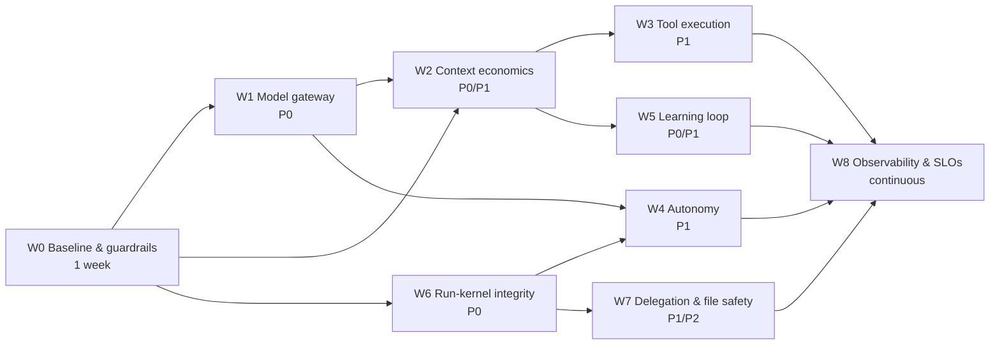

# Hermes-Inspired Harness Improvement Plan

This is the detailed engineering plan for closing the gaps identified in
`docs/research/hermes-vs-eclipse/`. It is deliberately **not** a rewrite. Every
workstream lands on an existing Eclipse seam, ships behind a flag, and has a
rollback.

The plan assumes:

- one senior engineer can own a workstream end-to-end;
- two engineers can run workstreams in parallel without touching the same files;
- the existing offline evaluation gate (`node scripts/test-evals.js`) and
  `npm run audit:agent` remain the release gates;
- no schema change is made outside `harness/migrations.py` or the additive
  `ALTER TABLE` pattern used by `run_lineage._ensure_schema`.

**Definition of done for every slice:** code + flag + tests + event/metric +
rollback note + `CHANGELOG.md` entry. A slice without a measurable acceptance
test is not done.

---

## 0. Programme map



| Workstream | Priority | Effort (engineer-weeks) | Depends on |
|---|---|---:|---|
| W0 Baseline, flags, measurement | P0 | 1 | — |
| W1 Model gateway | P0 | 2.5–3 | W0 |
| W2 Context economics | P0/P1 | 3–4 | W0, W1 |
| W3 Tool execution | P1 | 2–3 | W0, W2 |
| W4 Autonomy | P1 | 4–5 | W1, W2, W6 |
| W5 Learning loop | P0/P1 | 4–5 | W0, W2 |
| W6 Run-kernel integrity & safety | P0 | 3–4 | W0 |
| W7 Delegation & file safety | P1/P2 | 3–4 | W6 |
| W8 Observability, SLOs, conformance | continuous | 1–2 | all |

Total: **23–31 engineer-weeks**. With two engineers working in parallel on
non-overlapping seams, a realistic 12–14 week programme with a two-week buffer.

---

## W0. Baseline, feature flags, and measurement (1 week)

> **Detailed plan:** `docs/harness/roadmap/w0-baseline-and-guardrails-plan.md`
> contains the metric dictionary, artifact schema, collector design, flag
> registry API, kill-switch tests, day-by-day schedule and exit criteria.

### Why first

Without a baseline, every later claim is opinion. Hermes-style changes can
easily make one metric better and another worse (for example, parallel tools
improve latency but increase provider 429s). Capture the baseline first.

### Deliverables

1. **A baseline run report** from the offline and live tiers:
   - p50/p95/p99 run latency, model-call latency, tool latency;
   - tokens per task, cost per task, model attempts per run;
   - terminal correctness, orphan rate, resume success, effect unknown count;
   - tool-error rate, duplicate-tool-call rate, context-overflow rate;
   - finance/research benchmark scores by category.
2. **A feature-flag registry** in `python/harness/config/flags.py` (new, small):
   a single parser for booleans with a documented default and an owner. No
   scattered `os.environ.get` for new work.
3. **A flag matrix** (see §10) checked into docs.
4. **A kill-switch test**: every new flag must be flippable at runtime or on
   restart without a schema change.
5. **A "no second seam" review checklist** for every PR: does it add a loop,
   scheduler, approval path, model client, tool registry, or event bus? If yes,
   reject.

### Acceptance

- Baseline report committed under `docs/harness/benchmarks/` with the commit
  sha and model/provider.
- `pytest python/tests/test_flags.py` covers default, env override, invalid
  value, and a restart.
- The report is reproducible by `npm run eval:live` (or the offline equivalent
  when no keys are present).

---

## W1. Live model gateway (P0, 2.5–3 engineer-weeks)

> **Detailed plan:** `docs/harness/roadmap/w1-model-gateway-plan.md` contains the
> candidate/retry/fallback matrix, credential pool, first-token watchdog,
> per-attempt accounting, slices W1.1–W1.6, fault matrix and rollout.

### Current path

```
graph.agent_node
  -> step.invoke_model_step
       -> retry_policy.retry_async
       -> model_stream.ainvoke_streaming
  -> graph calls runtime.record_step
```

`ModelRuntime.invoke` (`model_runtime/runtime.py:454`) already implements
candidate selection, circuits, rate limits, retries, fallback and accounting,
but the graph never calls it. `stream_for_graph` (`runtime.py:632`) exists and
is unused. `step.py` explicitly says it "deliberately does NOT classify or wrap
the final exception", and its docstring records that the runtime was bypassed.

### Target path

```
graph.agent_node
  -> ModelGateway.stream(GatewayRequest)
       -> candidate plan (primary + fallbacks, credential filter)
       -> per candidate: circuit / rate / credential acquire
       -> build model (runtime.build)
       -> ainvoke_streaming with first-token + total timeout
       -> classify error -> retry same candidate or advance
       -> record attempt (usage, cost, latency, outcome)
  -> returns GatewayResult(response, attempts, fallbackUsed)
```

`graph.agent_node` keeps its existing error handling (context overflow,
deadline, provider failure) but no longer calls `record_step` itself.

### New module: `python/harness/model_runtime/gateway.py`

```python
@dataclass(frozen=True)
class GatewayRequest:
    model: Any
    messages: list[Any]
    timeout_s: float
    finalizing: bool
    emitter: Any
    resolution: Resolution
    deadline: RunDeadline | None
    run_id: str
    step: int
    task: str = "agent"

@dataclass(frozen=True)
class Attempt:
    index: int
    provider: str
    model: str
    credential_id: str | None
    started_at_ms: int
    latency_ms: int
    outcome: str          # completed | retryable | failed | circuit_open | rate_limited
    error_class: str | None
    status_code: int | None
    prompt_tokens: int
    completion_tokens: int
    cost_usd: float | None
    priced: bool

@dataclass(frozen=True)
class GatewayResult:
    response: Any
    attempts: tuple[Attempt, ...]
    fallback_used: bool
```

`ModelGateway.stream(req) -> GatewayResult` algorithm:

1. Build `candidates` from `resolution.model` then `resolution.decision.fallbacks`.
2. Drop candidates whose provider has no credential **unless** the provider is
   keyless/local (the existing `_constrain` rule).
3. For each candidate:
   - if the model or provider circuit is open, record `circuit_open` and skip;
   - if the rate limiter refuses, record `rate_limited` and skip;
   - acquire a credential from `CredentialPool` (if configured);
   - build the model with `runtime.build` / `runtime.fallback_build`;
   - loop attempts up to `RetryPolicy.attempts`:
     - call `ainvoke_streaming` with a `first_token_timeout` wrapper;
     - on success, record usage/cost and return;
     - classify the exception; if retryable and no delta has streamed and the
       deadline permits, back off and retry;
     - if fallback-class, break to the next candidate;
     - if not retryable, raise the original (preserve current behaviour).
4. If all candidates fail, raise the best classified error with the full
   attempt trace in `ModelError.detail`.

### New module: `python/harness/model_runtime/credential_pool.py`

```python
@dataclass
class Credential:
    id: str
    provider: str
    api_key: str
    base_url: str | None
    label: str
    cooldown_until_ms: int = 0

class CredentialPool:
    def acquire(self, provider: str) -> Credential | None: ...
    def record_success(self, credential: Credential) -> None: ...
    def record_failure(self, credential: Credential, *, status: int | None,
                       retry_after_s: float | None) -> None: ...
    def available(self, provider: str) -> bool: ...
```

Rules:

- A 429/402 puts the credential in cooldown (honour `Retry-After`; otherwise
  exponential 30 s → 60 s → 300 s, cap 900 s).
- A 401/403 marks the credential unhealthy and rotates immediately.
- A successful call clears the cooldown and increments a success counter.
- Keys never appear in events, logs or traces; only `credential_id` and
  `label` (redacted).
- If no pool is configured, the gateway uses the run's single key, exactly as
  today.

### Streaming watchdog

`ainvoke_streaming` already has a hard timeout, but a provider can open a
stream and never send a token. Add a `FirstTokenWatchdog`:

- `first_token_timeout_s` default 45 s, configurable per provider.
- If no `model.delta` and no tool-call chunk arrives, cancel the stream and
  classify as `TIMEOUT`.
- Once any delta has arrived, do **not** retry (would duplicate text); the
  existing `_CountingEmitter` rule remains.
- Emit `model.first_token` with latency so the dashboard can show provider
  stall behaviour.

### Slices

| Slice | Change | Behaviour | Acceptance |
|---|---|---|---|
| W1.1 | Add `gateway.py` + `Attempt` records; call existing `invoke_model_step`; emit `model.attempt` events | No behaviour change (shadow) | Events contain candidate plan + attempt timings; all existing model tests pass |
| W1.2 | Route through `runtime.invoke` for same-provider retries | Same provider, same key | 500 → retry → success; 401 → no retry; `run.failed` preserved |
| W1.3 | Add `CredentialPool`; enable cross-provider fallback when keys exist | Failover | 429 rotates key; 5xx falls back; no-key provider skipped; secrets absent from events |
| W1.4 | Add first-token watchdog | Faster failure | Hanging stream at 45 s → `PROVIDER_TIMEOUT`; stall after a delta → no retry |
| W1.5 | Per-attempt usage/cost; run budget cap | Cost control | `costUsd` sums all attempts; unknown model → `null`; `maxCostUsd` fails the run cleanly |
| W1.6 | Remove the bypass; unify `HARNESS_MODEL_RETRIES` into `HARNESS_MODEL_ATTEMPTS`; delete dead code | Clean | One retry knob; `stream_for_graph` delegates or is removed; docs updated |

### Files touched

- `model_runtime/gateway.py` (new)
- `model_runtime/credential_pool.py` (new)
- `model_runtime/runtime.py` (`invoke`, `stream_for_graph`, `_record_*`)
- `model_runtime/errors.py` (attempt detail)
- `step.py` (thin adapter; delete its retry loop or delegate)
- `graph.py` (`agent_node` call site, remove `record_step`, pass `resolution`)
- `retry_policy.py` (one env name, one default)
- `observability/integration.py` (new `model.attempt` mapping)
- `run_cost.py` (sum attempts)
- `config/flags.py` (new)

### Tests

- `python/tests/test_model_gateway.py`:
  - success on primary;
  - 429 → retry same key → success;
  - 429 → cooldown → next credential;
  - 500 → fallback provider;
  - 401 → no retry, no fallback unless another provider has a key;
  - circuit open → skip;
  - first-token timeout;
  - stall after delta → no retry;
  - all candidates fail → original exception preserved;
  - usage/cost per attempt;
  - unknown model → `priced: false`, `costUsd: null`.
- `python/tests/test_step_retry.py` (update to the gateway seam).
- `python/tests/test_model_runtime.py` (existing invariants).
- `python/tests/test_graph_agent_node.py` (error handling).
- `evaluation/conformance/cases.py`: a provider-fault case.

### Rollout

`HARNESS_MODEL_GATEWAY=shadow|on|off`:

1. **shadow** — gateway plans and records, existing call still runs.
2. **on, same provider** — one release.
3. **on, cross-provider** — after the credential pool is verified.
4. **remove shadow** — after two green weeks on the live tier.

### Risks

| Risk | Mitigation |
|---|---|
| Fallback hides a persistent auth failure | Emit `model.fallback`; fail if all candidates fail; dashboard alert on fallback rate |
| Cost blow-up from retries | Per-run cost cap; one usage row per attempt; alert on attempts/run |
| Smaller fallback context window | Re-run budget after fallback; refuse a fallback whose declared window cannot hold the request |
| Credential leak | Never log keys; `credential_id` only; redaction test |
| Double-counted usage | One `Attempt` row per physical call; `run_cost` sums rows |

---

## W2. Context economics (P0/P1, 3–4 engineer-weeks)

> **Detailed plan:** `docs/harness/roadmap/w2-context-economics-plan.md` contains
> the usage-anchor schema, budget gates, prune→summary→skeleton ladder,
> prompt-cache tiers, any-step overflow recovery, slices W2.1–W2.7 and fault matrix.

### Current state

- `context_budget.compute_history_budget` estimates at **4 chars/token** and
  reserves 1024 output tokens; unknown window ⇒ inert budget.
- `history.MAX_HISTORY_TURNS = 20`, `MAX_HISTORY_CHARS = 40_000`.
- `compaction.py` builds a deterministic skeleton (12 items × 400 chars) and
  optionally a model narrative (default off, 20 s timeout).
- `_retry_with_tighter_budget` only recovers at **step ≤ 1**.
- `prompt_segments.py` has a `prompt_cache_key` but no provider cache markers.
- The system prompt is rebuilt per run; within a run it is stable.

### Target

1. **Usage anchor** — use the provider's real prompt tokens plus a bounded
   estimate of what was appended since that response.
2. **Gate on measured pressure**, not a whole-context guess.
3. **Compression ladder** — prune → summarise → deterministic fallback, with
   cooldown and a protected tail.
4. **Prompt-cache-stable tiers** — stable prefix, run-frozen context, volatile
   user turn; do not mutate the prefix mid-run.
5. **Overflow recovery after step 1** when it is safe (no unconfirmed effect,
   valid checkpoint).

### New module: `python/harness/context/usage_anchor.py`

Schema (additive, `agent-memory.db`):

```sql
CREATE TABLE IF NOT EXISTS SessionUsageAnchor (
  sessionId          TEXT PRIMARY KEY,
  modelKey           TEXT NOT NULL,
  provider           TEXT NOT NULL,
  model              TEXT NOT NULL,
  promptTokens       INTEGER NOT NULL,
  completionTokens   INTEGER NOT NULL,
  anchorMessageId    TEXT,
  anchorFingerprint  TEXT NOT NULL,
  appendedEstimate   INTEGER NOT NULL,
  contextLength      INTEGER,
  anchored           INTEGER NOT NULL,
  updatedAt          TEXT NOT NULL
);
```

```python
@dataclass
class UsageAnchor:
    session_id: str
    model_key: str
    prompt_tokens: int
    completion_tokens: int
    anchor_fingerprint: str
    appended_estimate: int
    context_length: int | None
    anchored: bool

def fingerprint(messages: list[Any]) -> str: ...
def estimate_used(anchor: UsageAnchor | None, messages: list[Any]) -> int: ...
```

Rules:

- Persist after every successful model call (gateway returns usage).
- Fingerprint the last request message (id + content hash); if it does not
  match, the anchor is stale and `anchored=False`.
- A model switch clears the anchor.
- A compaction clears the anchor (the next response re-establishes it).
- If the provider omits usage, store `anchored=False` and fall back to the
  current estimate.

### Budget change

`compute_history_budget` gains `anchor: UsageAnchor | None`:

```
if anchor valid and anchor.model_key == current model key:
    used = anchor.prompt_tokens + estimate_tokens(messages since anchor)
    usable = window - used - reserved_output
else:
    used = sum(component estimates)
    usable = window - used - reserved_output
```

- If `used/window >= 0.50` → compression candidate.
- If `used/window >= 0.85` → mandatory compaction before the call.
- If `usable <= 0` → refuse the call with `CONTEXT_EXHAUSTED` (honest, not a
  provider 400).

### Compression ladder

`python/harness/context/compression_ladder.py`:

```
Stage 0: prune_old_tool_results(messages, keep_last=N)
Stage 1: summarize_dropped(dropped, model, timeout=20s)
Stage 2: deterministic skeleton (always succeeds)
Stage 3: if no stage produced a smaller prompt -> do not compact; fail honestly
```

Rules:

- **Prune** old tool results first: replace with
  `[pruned tool result: name, original_chars, output_id]`; never prune an
  evidence/claim handle, a file read ledger entry, or the last N tool results.
- **Protect** the last `protect_turns` (default 8) and the last user turn; never
  split an assistant/tool pair.
- **Summary** is structured: decisions, facts, unresolved questions, files,
  tool handles, and the next action. Cap 10k tokens.
- **Cooldown** per session: 60 s → 300 s → 900 s on timeout/stall; 30 s on
  JSON/empty. While armed, threshold-triggered compression is skipped;
  `/compact` forces.
- **Deterministic fallback** commits the skeleton through the same durable
  path; it is labelled `deterministic` and never claims a model summary.
- **Never compact the EvidenceLedger**: claims/handles are durable in
  `goals/` and injected separately.

### Prompt-cache-stable tiers

Use `prompt_segments` to build:

```
[stable]   identity + system policy + tool guidance + skill index
[context]  project rules + profile + skill manifest + memory block
[volatile] session summary + runtime context + user turn
```

- The stable tier must be byte-identical for the life of a run. Do not inject
  memory/skills into the system prompt mid-run; use a system message after the
  history or a user-message sidecar, as Hermes does.
- Add provider cache markers where supported:
  - Anthropic: `cache_control: {"type": "ephemeral"}` on the last stable block
    and the last tool definition.
  - OpenAI-compatible: rely on prefix ordering; no explicit marker.
  - Unknown provider: no marker, no failure.
- Record `prompt.cache` event with `cacheKey`, `stableChars`, `markerCount`.

### Any-step overflow recovery

Replace the `step > 1` refusal with a guarded recovery:

1. If the provider rejects for context length and `step > 1`:
   - require a latest checkpoint;
   - require `RunEffects` has no `started` row for this run (or all `done`);
   - rebuild from the checkpoint messages, not the live message list;
   - recompute the budget with the anchor and a tighter margin;
   - retry **once** with a `context.recovered` event.
2. If any condition fails, keep today's honest `CONTEXT_OVERFLOW`.

This preserves the side-effect safety that motivated the first-step rule while
allowing a long research run to recover.

### Slices

| Slice | Change | Acceptance |
|---|---|---|
| W2.1 | Add anchor table + store; gateway records usage | Anchor rows exist; stale fingerprint detected; model switch clears |
| W2.2 | Budget gates on anchor; unknown usage falls back | 200k window: prompt never exceeds; 50%/85% gates fire; unknown window inert |
| W2.3 | Prune old tool results before summary | Prompt shrinks without a model call; evidence handles preserved |
| W2.4 | Ladder + cooldown + deterministic fallback | Timeout → skeleton; second stall → skeleton; `/compact` forces |
| W2.5 | Any-step overflow recovery | Overflow at step 8 with a clean checkpoint resumes; with an unknown effect it fails honestly |
| W2.6 | Cache-stable tiers + markers | Stable prefix bytes unchanged across a run; Anthropic cache hit rate improves in A/B |

### Files touched

- `context_budget.py` (anchor input, `CONTEXT_EXHAUSTED`)
- `history.py` (`_bounded_history` uses anchor)
- `compaction.py` (prune + structured summary + cooldown)
- new `context/usage_anchor.py`, `context/compression_ladder.py`
- `prompt_segments.py` (tier plan + cache markers)
- `graph.py` (`_assemble_run_messages`, `_retry_with_tighter_budget`)
- `persistence.py` (anchor table if not in a separate store)
- `model_runtime/gateway.py` (usage callback)

### Tests

- `test_context_budget.py`: anchor/no anchor, unknown window, model switch,
  stale fingerprint, 50/85 thresholds, `CONTEXT_EXHAUSTED`.
- `test_context_overflow.py`: step 1, step 8 with checkpoint, step 8 with an
  unknown effect.
- `test_history_compaction.py`: prune, protect tail, tool-pair integrity,
  deterministic fallback, cooldown.
- `test_prompt_segments.py`: stable bytes, cache markers, no mid-run mutation.
- New `test_usage_anchor.py`.

### Risks

| Risk | Mitigation |
|---|---|
| Anchor wrong after a provider change | Fingerprint + model key; clear on mismatch |
| Over-compression loses evidence | Never compact evidence; preserve handles; deterministic skeleton |
| Cache markers break a provider | Marker capability per provider; no marker on unknown |
| Any-step recovery re-runs a tool | Require checkpoint + no `started` effect; rebuild from checkpoint |
| Summary cost | Cooldown; one attempt; deterministic fallback |

---

## W3. Tool execution: parallel, guardrailed, discoverable (P1, 2–3 engineer-weeks)

> **Detailed plan:** `docs/harness/roadmap/w3-tool-execution-plan.md` contains
> the partition rules (contiguous batches only), per-call context cloning, the
> success-signature guardrail contract, BM25/tier/catalogue design, the
> concurrency audit, fault matrix, slices W3.0–W3.4 and exit criteria. This
> section is the summary; the detailed plan wins on any conflict.

### W3.1 Parallel read-only batch

Current `tools_node` loop:

```
for call in calls:
    budget check
    duplicate check
    resume idempotency
    plugin before hook
    effects begin
    registry.execute
    effects finish
    append ToolMessage
```

Target:

```
plan = partition(calls)          # CONTIGUOUS parallel-safe runs only
  read_only  -> one batch (Semaphore N)
  effectful  -> ordered, serial
  interactive-> exclusive, ordered
execute:
  - pre-flight budget and duplicate check for every call (ordered)
  - create result slots in original order
  - gather each read-only batch with per-call timeout
  - run effectful/interactive sequentially
  - append results in original order
```

`[read A, write B, read C]` is three slots, never `[[A, C], [B]]`: B may depend
on A, and C may depend on B.

Add `ToolDefinition` fields:

```python
interactive: bool = False         # clarify, ask_user, approval
parallel_safe: bool | None = None # None = registry policy, not a handler guess
```

W3.1 ships an explicit `parallel_safe=True` allowlist; "permission == read" is
not proof of concurrency safety (caches/stores/providers). Each batch call gets
a `dataclasses.replace(ctx)` shallow clone so per-call fields do not race.

`ToolRegistry.execute` remains the single dispatch seam; no parallel path may
call a handler directly.

Rules:

- `HARNESS_TOOL_CONCURRENCY` default 6, clamp 1..12.
- A read-only batch has its own deadline: `min(run_deadline, batch_timeout)`,
  default 120 s.
- One failed read-only call does not cancel the others; it gets an error slot.
- On outer cancellation, cancel all outstanding tasks and append a cancelled
  result for each missing call.
- Effectful calls still call `effects.begin` before dispatch and `finish` after.
- Plugin `before_tool_call` runs in pre-flight (original order) and
  `after_tool_call` runs once the call's result exists; neither is coalesced.
- The tool budget is decremented before dispatch, in order; a call that cannot
  start gets `TOOL_BUDGET_EXCEEDED` in its slot.

### W3.2 Tool guardrails

New `python/harness/tools/guardrails.py` — pure rules (no I/O, no model). It
reuses `attempt_digest` from `recovery/progress.py` and observes **successes**;
the existing `ProgressTracker` observes failures. This is not a second loop.

```python
@dataclass
class ToolSignature:
    name: str
    args_hash: str
    result_hash: str | None

@dataclass
class GuardrailDecision:
    action: str   # allow | warn | halt
    rule: str     # identical_call | cycle | failure_streak | budget
    count: int
    message: str
```

Controller rules:

- Identical call threshold 3 (name + canonical args + result hash).
- Cycle detection: a repeated sequence of length 2–4 within the last 64
  observations.
- Failure streak: 4 consecutive failures with no state change.
- Repeatable allowlist: `read_tool_output`, `process_manage`, `*_get_result`,
  `*_poll`, `clarify`.
- `warn` appends a directive to the tool result; `halt` returns a controlled
  final answer and sets `state["guardrail_halt"]`.
- Never halt a call that is the first of its signature.
- Emit `tool.guardrail` with rule/count/tool.
- Operator reset endpoint clears the controller for a run.

### W3.3 Tool disclosure

Current: lexical `_score`, `HARNESS_LAZY_TOOLS` opt-in, `tool_invoke` read-only.

Target:

- Add `tools/bm25.py` (small, pure Python; reuse the tokenisation ideas from
  `eclipse_memory/hybrid.py`, do not import the experimental module).
- Index fields: name (weight 4), tags (2), description (1), domain (1).
- Exact-name match always ranks first.
- Activation: when advertised schema tokens exceed
  `HARNESS_TOOL_DISCLOSURE_THRESHOLD_PCT` (default 8%) of the model window,
  replace long-tail read-only tools with the `tool_search`/`tool_invoke` bridge.
- Tiered **catalogue block** (a prompt block, not a bound schema): tier 1
  names + one-line descriptions (budget 4k tokens); tier 2 names only (2k);
  tier 3 per-domain summary (`browser: 84 tools`, `quant: 55 tools`).
- `ToolDefinition` gains additive `tags: tuple[str, ...] = ()` and
  `domain: str = ""`; neither appears in the model-facing schema.
- `tool_search` returns `availableSources` when there is no match.
- Keep effectful tools bound; do not hide them behind `tool_invoke`.
- Add a `tool.disclosure` event with `mode`, `tier`, `advertisedTools`,
  `hiddenTools`, `toolSchemaTokens`, `catalogTokens`, `savedTokens`, `window`,
  `thresholdPct`; mirror the counts onto the run's `surface` payload.
- `HARNESS_LAZY_TOOLS` becomes a deprecated alias for
  `HARNESS_TOOL_DISCLOSURE=on`; the registry flag wins.

### Slices

| Slice | Change | Acceptance |
|---|---|---|
| W3.0 | Flags + shadow instrumentation | No dispatch change; `off` is byte-identical to today |
| W3.1 | Partition + contiguous read-only batches | 6×200 ms tools finish in ≤350 ms; order preserved; one failure isolated; effectful never overlaps |
| W3.2 | Guardrail controller | 3 identical successful calls halt with a clear message; changed args allowed; pollers exempt |
| W3.3 | BM25 + tiered catalogue | Recall@5 ≥0.90 on a labelled query set; advertised tokens drop ≥50% on >1,000 tools |
| W3.4 | Default-on auto threshold | Lazy activates only above 8%; explicit `on/off` works; alias removed |

### Files

- `graph.py` (`tools_node` wiring and the guardrail-halt route — no new bodies)
- `tools.py` (`ToolDefinition` fields; execution seam unchanged)
- `tool_batches.py` (new: partition, slots, context clone)
- `tools/guardrails.py` (new), `tools/bm25.py` (new)
- `tool_disclosure.py` (new: mode/threshold/tier/catalogue), `tool_surface.py`
- `routers/recovery.py` (operator reset endpoint)
- `config/flags.py` (new values), `context_budget.py` (measurement only)

### Tests

- `test_parallel_tools.py`: ordering, contiguous batches, semaphore,
  failure isolation, cancellation, budget, effect safety, context clone.
- `test_tool_guardrails.py`: identical/cycle/streak/poller/reset/off.
- `test_tool_disclosure_bm25.py`: recall set, exact-name boost, tags/domain,
  tier degradation, `availableSources`.
- `test_tool_surface.py` (existing) updated.
- `test_tool_catalog.py`: tier budgets, byte-stable block, token accounting.
- Timing test with a fake 200 ms tool ×6.

### Risks

| Risk | Mitigation |
|---|---|
| Provider 429s from parallel reads | Per-provider rate limit; semaphore; retry at tool layer |
| Shared cache race | Retrieval cache is already deduped; add a lock per key if needed |
| Effectful call races | Only read-only concurrent; effectful serial |
| A tool missed by search | Tiered listing + `availableSources` + exact-name boost |
| Guardrail false positive | Repeatable list + operator reset + warn-first release |

---

## W4. Autonomy: goal, loop, heartbeat (P1, 4–5 engineer-weeks)

> **Detailed plan:** `docs/harness/roadmap/w4-autonomy-plan.md` contains the
> contract/migration DDL, the closed gate vocabulary, the judge schema, the
> continuation/no-progress rules, the loop/heartbeat tick, the flag split
> (`HARNESS_GOAL_LOOP` vs the existing `HARNESS_AUTONOMY` kill switch), slices
> W4.0–W4.7, tests and rollout.

### Existing pieces to reuse

- `goals/model.py`: `Goal`, `Plan`, `PlanStep`, `Claim`, `Verdict`.
- `goals/store.py`: `GoalRecord`, `GoalPlan`, `GoalStep`, `EvidenceClaim`,
  `PlanIteration`.
- `goals/runtime.py`: `PlanRuntime`, step prompt, claims, verifiers, replan,
  settle.
- `tasks/`: durable DAG scheduler, leases, verification, goal budgets.
- `jobs/` and `automation/`: durable schedules, triggers, delivery.
- `goals/answer.py`: evidence enforcement at the answer seam.

**Do not add a new scheduler or a second goal store.** Extend the existing
tables and use `tasks`/`jobs` to start runs.

### New contracts

Extend `goals/model.py`:

```python
@dataclass
class GoalContract:
    outcome: str
    verification: tuple[str, ...] = ()
    constraints: tuple[str, ...] = ()
    boundaries: tuple[str, ...] = ()
    stop_when: tuple[str, ...] = ()

@dataclass
class GoalGate:
    id: str
    command: str
    timeout_s: int = 300
    retries: int = 3

@dataclass
class GoalVerdict:
    verdict: str          # done | continue | blocked | wait
    reason: str
    evidence: tuple[str, ...] = ()
    gate_results: tuple[dict, ...] = ()
```

Add to `Goal`:

```python
contract: GoalContract | None = None
gates: list[GoalGate] = field(default_factory=list)
max_turns: int = 20
used_turns: int = 0
last_verdict: GoalVerdict | None = None
session_id: str | None = None
```

Add an additive migration for the new columns/tables in
`goals/store.py` via `MigrationRunner`.

### Goal runtime

New `python/harness/autonomy/goal_runtime.py`:

```python
class GoalRuntime:
    def create(self, objective: str, contract: GoalContract | None,
               gates: list[GoalGate], max_turns: int) -> Goal: ...
    def start_next_turn(self, goal_id: str) -> str:
        """Create a run via the existing task/job seam; return run_id."""
    def evaluate(self, goal_id: str, run_id: str) -> GoalVerdict:
        """Run gates first; only if all pass, call the judge."""
    def apply(self, goal_id: str, verdict: GoalVerdict) -> str:
        """done|continue|blocked|wait|paused."""
```

`evaluate` order:

1. Run deterministic gates as subprocesses through the existing terminal
   sandbox (no shell metacharacters; fixed argv). Capture exit code and last
   3 KB of output.
2. Any failing gate ⇒ `continue` (or `blocked` after retries exhausted). The
   judge is **not** called.
3. All gates pass ⇒ call an auxiliary model with a strict JSON schema
   (`done|continue|blocked|wait`, reason, evidence handles).
4. Validate the judge output; on invalid JSON, treat as `continue` once, then
   `blocked`.

Continuation:

- `continue` starts a new run with the same `goalId`, a generated
  continuation prompt, the contract, the last gate output, and the evidence
  summary. It does **not** replay the whole transcript.
- `wait` parks on a process id or a condition; `tasks`/`automation` wakes it.
- Turn budget exhausted ⇒ `paused` with a clear reason.

### Loop and heartbeat

- `/loop [interval] <prompt>`: store a `Loop` record in the session; the
  existing `automation` engine (or a small session tick) starts a run on the
  cadence. Fixed interval and self-paced (1→2→4→8→15 min) modes.
- `/heartbeat every <interval> <prompt>`: idle-only, same session; coalesce
  missed ticks; user messages win.
- Both use a `maxTicks` cap and a no-busywork rule: if the reply is unchanged
  (digest), do not deliver.
- Cancellation is cooperative and immediate at a turn boundary.

### API/UI

- `POST /goals`, `GET /goals/{id}`, `POST /goals/{id}/pause|resume|cancel`,
  `GET /goals/{id}/verdicts`.
- Chat commands `/goal`, `/goal status`, `/goal pause`, `/subgoal`, `/loop`,
  `/heartbeat`.
- Chat dock: goal bar with turns used, last gate status, next wakeup.

### Slices

| Slice | Change | Acceptance |
|---|---|---|
| W4.1 | Goal contract + gates + migration | Create/read/update goal; old goals load unchanged |
| W4.2 | Deterministic gate runner + judge | Failing gate never calls the judge; pass + done completes |
| W4.3 | Continuation run | continue starts a new run with goal id; budget respected |
| W4.4 | Loop + heartbeat | Fixed/self-paced; caps; no mid-run fire; resume restores |
| W4.5 | API + chat UI | Commands work in CLI and chat; cancellation immediate |

### Files

- `goals/model.py`, `goals/store.py`, `goals/runtime.py`
- new `autonomy/goal_runtime.py`, `autonomy/loop_runtime.py`
- `tasks/` (start a run with goal context)
- `routers/sessions.py` or new `routers/goals.py`
- `src/components/chat/*` (goal bar)
- `src/lib/harness/commands/*` (slash commands)

### Tests

- `test_goal_runtime.py`: gate pass/fail, judge continue/done/blocked/wait,
  invalid JSON, budget, pause/resume.
- `test_loop_runtime.py`: fixed cadence, self-paced backoff, maxTicks,
  cancellation, hash-based no-change.
- `test_heartbeat.py`: idle-only, coalescing, user priority.
- `test_autonomy_resume.py`: resume restores goal + loop.
- API tests.

### Risks

| Risk | Mitigation |
|---|---|
| Runaway spend | maxTurns, maxTokens, maxTicks, cost cap, pause on no-progress |
| Judge says continue forever | Gate + judge + no-progress counter; hard budget |
| Goal fights user input | User message always wins; pause on user interrupt |
| Gate command hangs | Timeout + sandbox + retries |
| New scheduler | Reuse `tasks`/`jobs`; no second tick loop |

---

## W5. Learning loop quality (P0/P1, 4–5 engineer-weeks)

> **Detailed companion:** `docs/harness/roadmap/w5-learning-loop-plan.md` — the
> file-level plan: current-path evidence, execution-eval contract and case
> kinds, curator tables/modes/hard rules, BM25 wiring and the labelled-eval
> acceptance, slices, test matrix and rollout.

### W5.1 Behavioural skill evaluation

Current `skills/evaluation.py:448 _run_cases` only validates schema/shape. Add
an execution tier:

```
static checks (fast)
  -> if pass, execution tier:
       for each case:
         run the skill through evaluation/runner.py in an isolated env
         grade with tool/state/artifact/citation/financial/honesty graders
       require >= min_cases and pass_rate >= threshold
  -> promotion_gate requires both tiers
```

New `skills/execution_eval.py`:

```python
@dataclass
class ExecutionEvalResult:
    ok: bool
    cases: int
    passed: int
    failed: int
    run_ids: tuple[str, ...]
    grader_scores: dict[str, float]
    reason: str

def evaluate_skill_execution(manifest, cases, *, runner, graders,
                             min_cases=3, min_pass_rate=0.8) -> ExecutionEvalResult
```

Rules:

- A skill with no cases is `needs_review`, never `passed`.
- `activate_version` requires an execution result whose `run_ids` exist.
- `SelfModificationExecutor._enable_skill` requires the execution result; the
  TTL/caps remain.
- Cache by `evaluation_fingerprint` + runner version + model key.
- A failing execution leaves the skill inert and records the failure.

### W5.2 Curator

New `skills/curator.py`:

- Cadence: every 24 h or after N new learned skills, only when idle.
- Inputs: skill registry, usage ledger, duplicate/near-duplicate report,
  content hashes, permissions, compliance tags.
- Deterministic pass: stale/archive suggestions, duplicate groups.
- LLM pass (optional): propose umbrella merges as **inert drafts** with a diff.
- Hard rules: never delete, never touch pinned/compliance/external skills,
  never widen permissions, preserve support files, require operator approval.
- Every run writes `CuratorRun` + `CuratorProposal` + a rollback snapshot.

`/learn`:

- A chat command that turns a source/conversation into a draft through
  `skills/authoring.py` + `draft.py`.
- It never auto-enables; it lands in the learning queue.

### W5.3 Hybrid memory retrieval

Current `eclipse_memory/hybrid.py` is explicitly unwired. Finish it:

- Move the BM25 core to `eclipse_memory/bm25.py` (pure, tested).
- `retrieval.retrieve_memories` computes:
  `score = lexical_score + bm25_weight * bm25 + recency + authority + ...`.
- Add a small embedding provider only when configured; otherwise BM25.
- Add periodic consolidation: run `consolidate_active` nightly or on boot +
  every N runs; never auto-resolve contradictions.
- Profile isolation: filter by `profile_id` where the request carries one.

### W5.4 Lesson feedback

- A mistake/lesson candidate can be injected only after adoption + a completed
  validation run (already true).
- Add a safe default path: `automatic_selective` can adopt a lesson after
  recurrence ≥ 3 and an offline eval improvement; otherwise it stays
  operator-gated.
- Track `lesson.injected` → `run.outcome`; retire lessons with a negative
  effect after N uses.
- Do not enable RSL by default; fix the simple loop first.

### Slices

| Slice | Change | Acceptance |
|---|---|---|
| W5.1 | Execution eval module | A learned skill cannot enable without a pass + run ids |
| W5.2 | Auto-enable gate | Existing static-only skills expire; new ones require execution |
| W5.3 | Curator dry-run | Produces proposals/diffs; changes nothing |
| W5.4 | Curator apply | Approved merge creates a new version and archives old; rollback works |
| W5.5 | Hybrid retrieval | Recall improves on the labelled eval without forbidden hits |
| W5.6 | `/learn` | Draft created, inert, visible in the learning queue |

### Tests

- `test_skill_execution_gate.py`, `test_skills_evaluation.py`,
  `test_self_modification.py`, `test_skill_lifecycle_e2e.py`.
- `test_skill_curator.py`: dry-run, approval, rollback, compliance preservation.
- `eclipse_memory/eval/` retrieval eval must not regress; add BM25 cases.
- `test_lesson_feedback.py` adoption/injection/retirement.

### Risks

| Risk | Mitigation |
|---|---|
| Execution eval cost | Cache fingerprint; min cases; cheap model for cases |
| Curator merges compliance text | Frozen fields; operator approval; no delete |
| Memory poisoning | BM25 only over native store; external fenced; no promotion |
| Overfitting lessons | Recurrence + validation run + outcome tracking |

---

## W6. Run-kernel integrity and safety (P0, 3–4 engineer-weeks)

> **Detailed plan:** `docs/harness/roadmap/w6-run-kernel-integrity-plan.md`
> contains the grounded current-state audit, the fenced-write and atomic-boundary
> contracts, the pre-dispatch idempotency states, the durable event-sequence
> migration, the lease-aware watchdog, the hardline/shell-sandbox design, slices
> W6.1–W6.7, fault matrix, rollout and exit criteria.

### W6.1 Fenced progress writes

Replace `store.update_run` at `graph.py:884` and `:1197` with
`fenced_update_run(store, run_id, runtime_id=..., **fields)`.

- `fenced_update_run` already has the SQL and a fallback for stores without
  lease columns.
- Pass the runtime id from `RunLeaseGuard`/`RunScope`; add it to `RunScope` if
  absent.
- On a fenced write returning `False`, stop the run with `RUN_LEASE_LOST`; do
  not continue writing.

### W6.2 Atomic checkpoint + messages

`_write_checkpoint` currently calls `save_messages` then `save_checkpoint`,
each committing. Add `RunLineage.save_boundary(run_id, kind, payload, messages)`:

```
BEGIN IMMEDIATE
  save_messages_locked(...)
  seq = next_seq_locked(...)
  insert RunCheckpoint
COMMIT
```

- `save_messages` and `save_checkpoint` keep their public signatures for
  compatibility, but the graph calls the atomic method.
- A failed boundary is retried once; if it still fails, the run fails with
  `CHECKPOINT_WRITE_FAILED` rather than silently continuing without a durable
  boundary.
- Add a `checkpoint_intent` marker for readers if a single transaction is too
  long; readers ignore an incomplete intent.

### W6.3 Pre-dispatch idempotency + effects

- Add `mark_tool_started(run_id, step, call_id, name)` before dispatch.
- `mark_tool_executed` becomes `mark_tool_done`.
- `was_tool_executed` returns `{state: started|done|unknown}`.
- On resume:
  - `done` → reuse the recorded result.
  - `started` → mark `unknown`, refuse re-execution, surface an operator
    reconciliation prompt.
- `RunEffects.begin` is written in the same transaction as the checkpoint
  (or immediately before dispatch with a durable `intent` marker).
- `finish` is in a `finally`; an exception path marks `unknown`, not `done`.

### W6.4 Event sequence ownership

`RunEmitter._seq` is per instance. Add `EventSequence`:

- `append_event` allocates `seq` inside `BEGIN IMMEDIATE`:
  `INSERT ... SELECT COALESCE(MAX(seq),0)+1`.
- The emitter asks the store for the next sequence; it no longer increments a
  local counter.
- `HarnessEvent.id` becomes `evt_<run>_<seq>` with a unique constraint; a
  collision retries once.
- `emit_transient` does not need persistence but must use a non-colliding
  `seq` or a `transient_<uuid>` id.

### W6.5 Lease-aware watchdog

`find_stalled` gets a `live_run_ids` set (or a callback) from
`RunLeaseManager.is_live`. Skip a run with a live lease, regardless of event
silence. This prevents a second runtime from failing another owner's run.

### W6.6 Safety floor + shell sandbox

- Add `security/hardline.py` with always-on patterns: root wipe, fork bomb,
  raw block-device write, curl|sh to root, recursive chmod on `/`.
- `security/floor.py` consults it before grants/YOLO.
- `HARNESS_EFFECT_TOKENS` default becomes `enforce` in production; `shadow`
  remains for development. Add a startup warning if shadow is active outside
  `NODE_ENV=development`.
- If `SecurityGateway` construction fails, `service.run` refuses effectful
  tools with `SECURITY_UNAVAILABLE` instead of continuing.
- Route `code/shell.py` through `code/sandbox.py`; if that is not possible in
  one slice, remove `spawn` from the agent surface and keep `run` only behind a
  sandbox check. Add tree kill.

### Slices

| Slice | Change | Acceptance |
|---|---|---|
| W6.1 | Fenced progress | Stale worker cannot write counters; run stops on lease loss |
| W6.2 | Atomic boundary | Kill between message and checkpoint resumes consistently |
| W6.3 | Pre-dispatch idempotency | Crash after `started` → `unknown`, never re-run |
| W6.4 | Event sequence | Two emitters no collision; no dropped events |
| W6.5 | Lease-aware watchdog | Live-lease run not failed by another runtime |
| W6.6 | Hardline + enforce | Replay blocked; hardline blocked even with grant; shell sandboxed |

### Tests

- `test_run_lease.py`: stale worker fence, lease loss.
- `test_run_lineage.py`: atomic boundary, concurrent seq, resume.
- `test_run_effects.py`: started/done/unknown.
- `test_events_bus.py`: two emitters, collision retry.
- `test_run_watchdog.py`: live lease skip.
- `test_hardline.py`, `test_shell_sandbox_parity.py`,
  `test_c6_effect_tokens.py`.

### Risks

| Risk | Mitigation |
|---|---|
| SQLite write lock contention | Short transaction; retry; WAL; no network inside |
| Atomic boundary latency | Measure; fall back to intent marker |
| Enforce breaks a workflow | Canary; shadow→warn→enforce; per-tool override with audit |
| Hardline false positive | Fixed patterns + tests; no user config |

---

## W7. Delegation v2 and file checkpoints (P1/P2, 3–4 engineer-weeks)

> **Detailed plan:** `docs/harness/roadmap/w7-delegation-and-file-safety-plan.md`
> contains the current-path evidence, the durable `HarnessDelegation`/steer
> tables, the Fabric-backed async lifecycle, the schema-repair contract, the
> steering boundary, per-child worktrees, the shadow-git checkpoint store and
> `/rollback` surface, slices W7.0–W7.6, the fault matrix, flags, rollout and
> exit criteria.

### W7.1 Async delegation

Extend `spawn/service.py` (already supports `spec.background` and Fabric jobs)
with tools:

- `delegate_async(tasks)` → delegation id + Fabric job ids.
- `delegate_status(job_ids | delegationId)` → statuses/progress.
- `delegate_result(job_id | delegationId)` → typed `ChildOutcome`; idempotent.
- `delegate_cancel(job_id | delegationId)` → cooperative cancel.
- `delegate_steer(job_id | delegationId, message)` → append a message at the
  child's next step boundary (never mid-tool).
- `delegate_wait(...)` → bounded wait used by the synchronous `delegate`
  wrapper.
- `delegate` stays as a synchronous wrapper; `HARNESS_ASYNC_DELEGATION=off`
  keeps the current in-process path exactly.

A completed child is persisted and delivered once: to the parent at its next
step if it is still running, otherwise as a durable card read through
`GET /delegations?parentRunId=...`.

`output_schema`:

- Add `output_schema` + `schema_repair` to `DelegationChild` and `SpawnSpec`.
- The child prompt includes the schema and "return ONLY JSON"; the schema is
  bounded (16 KB) and never resolves a remote `$ref`.
- The parent validates with `jsonschema` (`Draft202012Validator`); on failure,
  exactly one bounded repair run with tools disabled and the validation errors.
- The result keeps the raw text plus `schemaValid`/`schemaErrors`/
  `repairAttempted`; a failed repair is never turned into a fabricated object.

Worktree:

- `code/worktree.allocate()` per child when `isolated=True`; the child's tool
  context points at the worktree; on completion, the parent gets a diff handle,
  not an automatic merge.

### W7.2 Shadow-git file checkpoints

New `code/checkpoints.py`:

- One bare repository under `.black-eclipse/checkpoints/store`.
- Per-project refs `refs/eclipse/<project-hash>/<utc>-<checkpointId>`; the
  commit message carries run id / turn key / reason, so no new database is
  introduced.
- Snapshot before mutating tools (`write_file`, `patch`, destructive terminal,
  promotion apply); a per-snapshot temporary `GIT_INDEX_FILE` never touches the
  user's index.
- At most one snapshot per project per turn; later mutations in the turn reuse
  it.
- Excludes: `.git`, `.black-eclipse`, `node_modules`, `.next*`, build outputs,
  databases, `.env`, artifacts, symlinks outside the project, files > 10 MB.
- `list`, `diff`, `restore(path?, all?)`; restore takes a pre-restore snapshot.
- Size cap + retention + prune; a full store refuses rather than grows.
- Tools: `checkpoint_list`, `checkpoint_diff`, `checkpoint_restore`
  (restore is effectful, single-use approval-gated).
- Routes and `/rollback`: list/diff/restore under `/code/checkpoints/*`; a
  routed, operator-gated `/rollback [id] [--all|--last]` with a diff preview
  and confirm, never an LLM turn.

### Slices

| Slice | Change | Acceptance |
|---|---|---|
| W7.0 | Flags, delegation tables, checkpoint scaffolding (shadow, no surface) | Migration once; kill switches; `off` is today |
| W7.1 | Async tools + status/result/cancel/wait; sync `delegate` wrapper | Parent continues; result once; cancel at boundary |
| W7.2 | `output_schema` + repair | Valid JSON passes; invalid gets one repair; raw text preserved |
| W7.3 | Steering | Child receives the message at the next step; no mid-tool injection |
| W7.4 | Worktree per child | Child writes isolated; diff returned; no auto-merge |
| W7.5 | Shadow checkpoints + `/rollback` | Bad edit listed/diffed/restored; protected paths untouched |
| W7.6 | Default-on after a green canary | Two green weeks; eval parity; no orphan/effect-unknown increase |

### Tests

- `test_delegate_async.py`, `test_output_schema_repair.py`,
  `test_delegate_steer.py`, `test_spawn_worktree.py`.
- `test_file_checkpoints.py`: snapshot, dedupe, restore, protected paths, size
  cap, pre-restore snapshot.

---

## W8. Observability, SLOs, and conformance (continuous)

> **Detailed plan:** `docs/harness/roadmap/w8-observability-and-slos-plan.md`
> contains the grounded current-state ledger (the gateway/context events are
> already emitted but not projected; objectives are registered lazily; the gate
> hardcodes five checks), the normative signal dictionary per workstream, the
> SLO/invariant catalog with targets and minimum samples, report schema v2, the
> data-driven gate design, alert rules, ten conformance cases, slices
> W8.0–W8.7, test matrix, rollout and exit criteria. This section is the
> summary; the detailed plan wins on any conflict.

For every workstream, add:

| Signal | Where | Alert |
|---|---|---|
| `model.attempt` count/latency/outcome | `observability/integration.py` | fallback rate > 10%, attempts/run > 3 |
| `context.anchor` accuracy, compaction rate, cooldown | same | overflow rate > 1%, compression failure > 5% |
| `tool.batch` size/concurrency/ordering violations | same | ordering violation > 0 |
| `tool.guardrail` halts | same | halt rate spike |
| `goal.verdict` by verdict/gate | same | `blocked` spike |
| `skill.execution_eval` pass/fail | same | auto-enable without eval = 0 |
| `checkpoint.write` failures | same | any failure |
| `effect.unknown` | existing | any unknown requires reconciliation |
| `run.lease_lost` | same | any occurrence |

Add SLOs:

- p95 run latency (existing).
- p95 time-to-first-token.
- context overflow rate.
- compression failure rate.
- fallback success rate.
- resume success rate.
- effect unknown rate (target 0).
- tool batch ordering violations (target 0).
- goal completion rate / blocked rate.

Add conformance cases:

- provider 429/500/stall;
- context overflow at step 8;
- tool batch with one timeout and one failure;
- two emitters;
- lease steal;
- effect replay;
- goal gate fail/pass;
- curator rollback.

---

## 9. Test strategy

### Test pyramid

1. **Unit** — pure functions (`UsageAnchor`, `ToolSignature`, BM25, gate
   parsing).
2. **Seam** — one real component with fakes at the boundary (`ModelGateway`
   with a fake provider, `tools_node` with fake tools, `GoalRuntime` with a
   fake judge).
3. **Integration** — real `execute_run`, real registry, real SQLite temp DB,
   fake model.
4. **Fault injection** — kill at the dangerous windows.
5. **Live canary** — 5% of runs, then 25%, then 100%, with the eval gate.

### Fault-injection matrix

| Window | Injection | Expected |
|---|---|---|
| After `agent_step` checkpoint, before dispatch | kill process | Resume at the checkpoint, no duplicate effect |
| After `effects.begin`, before tool | kill process | `unknown`, no re-execution |
| During a read-only batch | one tool raises | Other results intact; error slot in order |
| Provider 500 | fake provider | Retry/fallback trace, no duplicate text |
| Provider stall before first token | fake stream | Timeout, fallback |
| Provider stall after delta | fake stream | No retry, partial answer or honest failure |
| Context overflow at step 8 | fake provider error | One recovery from checkpoint |
| Two emitters | concurrent emit | No ID collision |
| Lease stolen | second runtime claims | Stale worker fenced |
| Goal gate fails | fake gate | Judge not called, `continue` |

### Evals

- Offline: `node scripts/test-evals.js` must stay ALL PASS.
- Add tasks for: fallback, context recovery, parallel tools, goal gate,
  skill execution gate, curator dry-run.
- Live: a small canary suite (`HARNESS_LIVE_CANARY=1`) with cost caps.
- Do not make a release claim from the scripted tier alone.

---

## 10. Feature flags

| Flag | Default | Values | Owner |
|---|---|---|---|
| `HARNESS_MODEL_GATEWAY` | `shadow` | `shadow|on|off` | W1 |
| `HARNESS_MODEL_ATTEMPTS` | `3` | 1..10 | W1 |
| `HARNESS_MODEL_FIRST_TOKEN_S` | `45` | seconds | W1 |
| `HARNESS_CREDENTIAL_POOL` | `on` | `on|off` | W1 |
| `HARNESS_USAGE_ANCHOR` | `on` | `on|off` | W2 |
| `HARNESS_COMPRESSION_LADDER` | `shadow` | `shadow|on|off` | W2 |
| `HARNESS_PARALLEL_TOOLS` | `off` | `shadow|on|off` | W3 |
| `HARNESS_TOOL_CONCURRENCY` | `6` | 1..12 | W3 |
| `HARNESS_TOOL_BATCH_TIMEOUT_S` | `120` | 10..600 | W3 |
| `HARNESS_TOOL_GUARDRAILS` | `warn` | `warn|halt|off` | W3 |
| `HARNESS_TOOL_DISCLOSURE` | `auto` | `auto|on|off` | W3 |
| `HARNESS_TOOL_DISCLOSURE_THRESHOLD_PCT` | `8` | 1..50 | W3 |
| `HARNESS_AUTONOMY` | `off` | `on|off` | W4 (global kill switch; pre-existing) |
| `HARNESS_GOAL_LOOP` | `off` | `off|shadow|on` | W4 |
| `HARNESS_GOAL_MAX_TURNS` | `20` | `1..100` | W4 |
| `HARNESS_SKILL_EXEC_EVAL` | `on` | `on|off` | W5 |
| `HARNESS_SKILL_CURATOR` | `dry_run` | `dry_run|propose|apply|off` | W5 |
| `HARNESS_MEMORY_HYBRID` | `off` | `on|off` | W5 |
| `HARNESS_FENCED_PROGRESS` | `on` | `on|off` | W6 |
| `HARNESS_CHECKPOINT_ATOMIC` | `on` | `on|off` | W6 |
| `HARNESS_EVENT_SEQ` | `on` | `on|off` | W6 |
| `HARNESS_EFFECT_TOKENS` | `enforce` (prod) | `shadow|enforce|off` | W6 |
| `HARNESS_FILE_CHECKPOINTS` | `off` | `off|warn|enforce` (`on`→`enforce`) | W7 |
| `HARNESS_FILE_CHECKPOINT_MAX_MB` | `500` | 50..5000 | W7 |
| `HARNESS_FILE_CHECKPOINT_RETENTION` | `50` | 1..500 | W7 |
| `HARNESS_ASYNC_DELEGATION` | `off` | `on|off` | W7 |
| `HARNESS_DELEGATION_SCHEMA_REPAIR` | `on` | `on|off` | W7 |
| `HARNESS_DELEGATION_STEER_MAX` | `4` | 0..8 | W7 |
| `HARNESS_DELEGATION_COMPLETION` | `card` | `card|continue|off` | W7 |
| `HARNESS_EVIDENCE_ENFORCE` | existing | `on|off` | W5 |

Rules:

- A flag default change requires an ADR and a canary.
- A flag must be readable without importing the runtime (config module only).
- A flag removal is a separate cleanup PR after two green weeks.

---

## 11. 12-week schedule

Assumes two engineers (A: runtime/model/context; B: tools/autonomy/learning),
with a shared reviewer.

| Week | Engineer A | Engineer B | Milestone |
|---|---|---|---|
| 1 | W0 baseline + flags | W0 eval/fault harness | Baseline report |
| 2 | W1.1–W1.2 gateway shadow/same-provider | W6.1–W6.2 fenced + atomic | P0 starts |
| 3 | W1.3–W1.5 credentials/fallback/watchdog | W6.3–W6.4 effects + event seq | Gateway canary |
| 4 | W1.6 cleanup; W2.1 anchor | W6.5–W6.6 watchdog/hardline | P0 run kernel green |
| 5 | W2.2–W2.3 gates + prune | W3.1 parallel tools | Context + tools canary |
| 6 | W2.4–W2.5 ladder + any-step | W3.2 guardrails | Long-run recovery |
| 7 | W2.6 cache tiers | W3.3–W3.4 disclosure | Context economics green |
| 8 | W4.1 goal contract + store | W5.1 execution eval | Autonomy + learning start |
| 9 | W4.2–W4.3 gates + continuation | W5.2 auto-enable gate | Goal loop works |
| 10 | W4.4–W4.5 loop/heartbeat/UI | W5.3–W5.4 curator | Autonomy UX |
| 11 | W7.1–W7.2 async + schema | W5.5–W5.6 hybrid + `/learn` | Delegation + learning |
| 12 | W7.3–W7.5 steering/worktree/checkpoints | W8 SLOs + conformance | Release candidate |

Buffer: weeks 13–14 for regressions, docs, and the canary ramp.

---

## 12. Risk register

| Risk | Likelihood | Impact | Mitigation |
|---|---|---|---|
| Gateway fallback hides a provider outage | Medium | High | Health dashboard; `model.fallback` event; alert |
| Context anchor is wrong | Medium | High | Fingerprint; clear on mismatch; deterministic fallback |
| Parallel tools cause provider 429s | High | Medium | Semaphore; per-provider limits; retry |
| Checkpoint atomicity slows runs | Medium | Medium | Measure; intent marker fallback |
| Enforce effect tokens break workflows | Medium | High | Shadow→warn→enforce; per-tool override; audit |
| Goal loop spends too much | Medium | High | Budgets, gates, pause on no-progress |
| Curator merges compliance text | Low | High | Frozen fields; operator approval; no delete |
| Skill execution eval is slow | Medium | Medium | Cache; min cases; cheap model |
| File checkpoints grow disk | High | Medium | Size cap; retention; excludes |
| Two schedulers | Medium | High | Reuse `tasks`/`jobs`; architecture review |
| Full test suite too slow | High | Medium | Targeted suites + nightly full; keep flags |

---

## 13. What not to build

- A second agent loop.
- A second scheduler.
- A second approval path.
- A second model client.
- A second tool registry.
- A second event bus.
- A second memory store.
- A generic "planner" that replaces `PlanRuntime`.
- A model-computed financial statistic.
- A plugin/memory provider that can write without approval.

If a proposal needs any of these, it needs an ADR before code.

---

## 14. First 10 working days

1. **Day 1** — run the baseline; record p50/p95, tokens/task, orphan rate,
   tool-error rate, context-overflow rate.
2. **Day 2** — add `config/flags.py` + tests; add the flag matrix doc.
3. **Day 3** — add `model_runtime/gateway.py` shadow path + `Attempt` events.
4. **Day 3** — add `RunLeaseGuard` runtime id to `RunScope`; switch one
   progress write to `fenced_update_run`.
5. **Day 4** — add `SessionUsageAnchor` + store; record usage from
   `runtime.record_step` (before the gateway is live).
6. **Day 5** — add `RunLineage.save_boundary` and route `_write_checkpoint`
   through it; fault-injection test.
7. **Day 6** — add `mark_tool_started` + `mark_tool_done`; resume test.
8. **Day 7** — add `EventSequence`; two-emitter test.
9. **Day 8** — add `tools/guardrails.py` in `warn` mode; tests.
10. **Day 9** — add parallel read-only batch behind `HARNESS_PARALLEL_TOOLS`;
    timing test.
11. **Day 10** — review the P0 metrics; decide whether the gateway can move
    from shadow to same-provider.

---

## 15. Acceptance gates for the programme

The programme is complete when:

1. **Reliability:** p95 run latency within 10% of baseline; orphan rate 0;
   effect-unknown rate 0 on the fault matrix; resume success ≥ 99%.
2. **Context:** context-overflow rate < 1% on long-run tasks; compression
   failure rate < 5%; no evidence loss in eval.
3. **Tools:** read-only batch latency reduced by ≥ 3× on a 6-call fixture;
   zero ordering violations; guardrail halts < 1% of runs.
4. **Autonomy:** a goal with a failing gate never completes; a passing goal
   completes; loop/heartbeat caps hold.
5. **Learning:** no learned skill enables without an execution pass; curator
   dry-run changes nothing; approved merge is reversible.
6. **Safety:** effect-token replay blocked in enforce; hardline commands
   blocked; shell cannot bypass the sandbox.
7. **Evaluation:** offline eval gate ALL PASS; live canary no regression;
   `npm run audit:agent` passes; `npx tsc --noEmit` clean.

---

## 16. Relationship to the research docs

This plan is the execution layer for:

- `EXECUTIVE-SUMMARY.md` — the ten ideas and the five 90-day investments.
- `ARCHITECTURE-COMPARISON.md` — the evidence for each gap.
- `ADOPTION-ANALYSIS.md` — what to copy, adapt, avoid.
- `TARGET-ARCHITECTURE.md` — the target component and data-flow design.
- `IMPLEMENTATION-ROADMAP.md` — the higher-level P0–P3 task list.
- `FEATURE-GAP-MATRIX.md` — the verified status ledger.

If this plan and those documents disagree, **this plan wins for sequencing and
file-level detail**; the research documents remain the evidence record. Any
change to a production contract still needs its own ADR.
