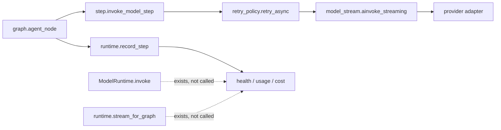
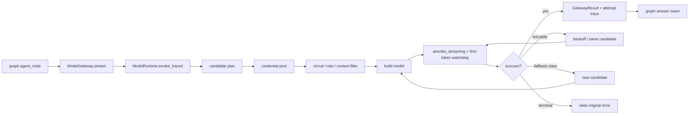

# W1 — Live Model Gateway

## Implementation status (2026-11-12)

**Landed:**

- `model_runtime/gateway.py` — gateway request/plan facade, `plan` (shadow) and
  `stream` (live), candidate tracing, attempt-event emission, first-token policy.
- `model_runtime/credential_pool.py` — per-provider keys, cooldown/rotation,
  safe snapshot.
- `model_runtime/runtime.py` — traced `invoke`, candidate credential rotation,
  per-attempt `ModelRequest`, `model.attempt.*` events, token cap.
- `model_stream.py` — first-token watchdog + `model.first_token` /
  `model.first_token_timeout`.
- `step.py` — mode-aware gateway adapter (`on` / `shadow` / `off`).
- `graph.py` — passes resolution, fallback builder, run id, token remainder and
  a per-run credential pool; success/error `record_step` calls removed.
- `run_cost.py` — attempt-based cost when `ModelRequest` rows exist; unpriced
  attempts keep the aggregate unpriced.
- Tests: `test_model_gateway.py`, extended `test_model_runtime.py`,
  `test_step_retry.py`, `test_graph.py`, `test_run_cost.py`; opt-in
  `test_model_gateway_live.py` runs only with `HARNESS_LIVE_MODEL_TEST=1`.
  `python/tests/conftest.py` resets the process-wide circuit/rate state per
  test so a later test is not refused by an earlier test's provider failures.
- Baseline: `docs/harness/baselines/w1-8f79bed4-2026-11-12.*` (74/74 terminal;
  offline/SLO/audit/conformance/tsc PASS; live NOT MEASURED).

`HARNESS_MODEL_GATEWAY` defaults to **`on`** after the offline verification;
`shadow` records the plan and keeps the legacy call, `off` disables the gateway.
The live tier is still not configured, so a paid-provider failover has not been
run. The full offline suite is green (**11,687 passed, 35 skipped**); the opt-in
live test is `test_model_gateway_live.py`.

**Not claimed:** a paid-provider live failover run.

W1 fixes the single largest reliability gap in Eclipse: **the live agent loop
does not use the model runtime that already exists.**

`ModelRuntime` has routing, circuits, rate limits, fallbacks, health, usage and
cost. The graph calls `step.invoke_model_step` → `ainvoke_streaming` and then
calls `runtime.record_step` after the fact. The runtime's `invoke` and
`stream_for_graph` paths are effectively unused on the only path that matters.

W1 makes one gateway the live path, without adding a second retry loop, model
client, scheduler or approval path.

**Duration:** 2.5–3 engineer-weeks.  
**Flag:** `HARNESS_MODEL_GATEWAY=shadow|on|off` (implementation default `on`;
`shadow` records only the plan and keeps the legacy call).  
**Dependency:** W0 baseline + flag registry (landed).

---

## 1. Goals

1. **One live model call path:** graph → gateway → `ModelRuntime` → provider.
2. **Classified failover:** 429/5xx/timeout/network failures can retry, rotate a
   credential, or move to a reachable fallback model.
3. **Credential rotation:** multiple keys per provider, with cooldown and health.
4. **Streaming health:** a provider that opens a stream and never sends a token
   fails fast instead of consuming the run deadline.
5. **Per-attempt accounting:** one `ModelRequest` row per physical attempt; cost
   and tokens include failed attempts; unknown pricing stays unknown.
6. **Budget integrity:** failed attempts count toward the run's token/cost
   budget, not only the final successful call.
7. **No behaviour change in shadow mode:** W1.1 records the plan and does not
   alter the existing call.

## 2. Non-goals

- No new provider SDK or adapter. Use `model_runtime/providers/`.
- No second retry loop. `ModelRuntime.invoke_traced` is the one loop.
- No new database. Attempts are `ModelRequest` rows.
- No silent cross-provider routing to a provider with no credential.
- No change to prompts, tools, context budget or financial semantics.
- No automatic fallback for `CONTEXT_OVERFLOW` unless the fallback has a larger
  declared window (see §7).

---

## 3. Current path



Problems:

- `retry_policy` owns retries but not fallback/circuit/rate limits.
- `ModelRuntime.invoke` owns fallback/circuit/rate limits but is bypassed.
- Cross-provider fallback is effectively dead because the graph never calls it.
- `record_step` sees one success/failure, not the attempts that preceded it.
- Failed attempts do not count toward the run budget.
- `HARNESS_MODEL_RETRIES` (runtime, default 1) and
  `HARNESS_MODEL_ATTEMPTS` (step, default 3) disagree.

---

## 4. Target path



The graph keeps its existing error handling (context overflow, deadline,
provider failure, final answer), but no longer calls `record_step` itself.

---

## 5. Contracts

### 5.1 `model_runtime/gateway.py`

```python
@dataclass(frozen=True)
class GatewayRequest:
    model: Any                       # already-built primary model
    messages: list[Any]
    timeout_s: float
    first_token_timeout_s: float
    finalizing: bool
    emitter: Any
    resolution: Resolution
    deadline: RunDeadline | None
    run_id: str
    step: int
    task: str = "agent"
    max_run_tokens: int | None = None
    fallback_build: Callable[[Any], Any] | None = None

@dataclass(frozen=True)
class Candidate:
    provider: str
    model: str
    index: int
    reason: str                     # primary | fallback | explicit
    credential_id: str | None
    context_window: int | None
    score: float | None
    model_info: Any = None          # ModelInfo when the catalog knows it
    built: Any = None               # set only for the primary/prebuilt candidate

@dataclass(frozen=True)
class Attempt:
    candidate: Candidate
    attempt: int                    # 1-based within the candidate
    outcome: str                    # completed | retryable | failed | skipped
    error_class: str | None
    status_code: int | None
    latency_ms: int
    ttft_ms: int | None
    prompt_tokens: int
    completion_tokens: int
    cost_usd: float | None
    priced: bool

@dataclass(frozen=True)
class GatewayResult:
    response: Any
    attempts: tuple[Attempt, ...]
    fallback_used: bool
    total_tokens: int
    cost_usd: float | None
```

`ModelGateway.stream(req) -> GatewayResult` is a thin facade. It calls
`ModelRuntime.invoke_traced(...)`; it does not implement a second candidate or
retry loop.

### 5.2 `ModelRuntime.invoke_traced`

Add to `model_runtime/runtime.py`:

```python
async def invoke_traced(
    self,
    *,
    invoke_fn: Callable[[Any], Any],
    primary_model: Any,
    resolution: Resolution,
    candidates: list[Candidate],
    fallback_build: Callable[[Any], Any] | None = None,
    credential_pool: CredentialPool | None = None,
    attempts: int | None = None,
    first_token_timeout_s: float = 45.0,
    on_attempt: Callable[[Attempt], None] | None = None,
    run_id: str = "",
    task: str = "agent",
    deadline: RunDeadline | None = None,
) -> GatewayResult: ...
```

`invoke` becomes a compatibility wrapper:

```python
async def invoke(self, **kwargs) -> Any:
    result = await self.invoke_traced(**kwargs)
    return result.response
```

This is the key design decision: **extend the existing invocation engine; do not
build a parallel one.**

### 5.3 `model_runtime/credential_pool.py`

```python
@dataclass
class Credential:
    id: str                  # stable opaque id, safe to log
    provider: str
    api_key: str
    base_url: str | None
    label: str
    cooldown_until: float = 0.0
    failures: int = 0

class CredentialPool:
    @classmethod
    def from_settings(cls, settings: Any, *, environ=None) -> "CredentialPool": ...
    def add(self, provider: str, api_key: str, *, label: str,
            base_url: str | None = None) -> Credential: ...
    def acquire(self, provider: str) -> Credential | None: ...
    def record_success(self, credential: Credential) -> None: ...
    def record_failure(self, credential: Credential, *,
                       status: int | None,
                       retry_after_s: float | None) -> None: ...
    def available(self, provider: str) -> bool: ...
    def snapshot(self) -> list[dict[str, Any]]: ...  # no keys
```

Rules:

- `from_settings` always adds the run's `settings.api_key` as one credential.
- Optional provider-scoped `HARNESS_<PROVIDER>_API_KEYS` (comma-separated) is
  read only when present; no new schema and no secret logging.
- A 429/402 sets a cooldown (`Retry-After`, else 30→60→300 s, cap 900 s).
- A 401/403 marks the credential unhealthy and rotates immediately.
- A success clears the cooldown.
- Events/DB contain `credential_id` and `label` only; never the key.
- If no pool is configured, the gateway uses the single run key exactly as today.

---

## 6. Candidate planning

`ModelRuntime.plan_candidates(resolution, *, credential_pool, messages, tools)`:

1. Start with `resolution.model` as candidate 0 (`reason=primary`).
2. Append `resolution.decision.fallbacks` in order (`reason=fallback`).
3. Drop a candidate when:
   - the provider has no credential and is not keyless/local;
   - the model or provider circuit is open;
   - `rate_limits.is_limited(model.qualified_id)` (defer, do not silently
     exhaust);
   - a required capability (from `resolution.decision.requirements.required`) is
     explicitly `UNSUPPORTED`;
   - its declared context window is smaller than the estimated request size;
   - `local_only` is set and the provider is not local.
4. De-duplicate by `provider/model`.
5. Cap at `1 + fallback_depth` (default 4).
6. Return `(candidates, excluded)` where `excluded` carries the reason for each
   dropped candidate. Emit `model.candidate_plan`.

Explicit model semantics:

- If the caller set an explicit model, it stays primary.
- The router may still supply fallbacks, but only if the caller configured
  `HARNESS_MODEL_FALLBACK` and a credential exists.
- A fallback may not silently change a required capability set. If the fallback
  cannot support the task, skip it with `capability_missing`.

Context estimate:

```python
estimate = sum(estimate_tokens(m.content) for m in messages)
         + estimate_tokens(json.dumps(tool_schemas))
         + reserved_output_tokens  # from context_budget
```

If the window is unknown, do **not** exclude the candidate; the provider may
accept it. Context overflow is handled by the existing context recovery (W2).

---

## 7. Retry and fallback matrix

The matrix is explicit because "retry" and "fallback" are different decisions.

| Error class | Same candidate retry? | Rotate credential? | Fallback candidate? | Notes |
|---|---|---|---|---|
| `rate_limit` (429) | Yes, honour `Retry-After`, bounded | Yes, next key | Yes, after keys exhausted | `record_429` |
| `timeout` | Yes, bounded | No | Yes | First-token or total timeout |
| `network_error` | Yes, bounded | No | Yes | DNS/connection/TLS |
| `server_error` (5xx) | Yes, bounded | No | Yes | 500/502/503/504 |
| `provider_unavailable` | No | No | Yes | Circuit may be open |
| `model_unavailable` | No | No | Yes | Try another model |
| `unknown_error` | Yes, bounded | No | Yes, after retries | Conservative |
| `authentication_error` (401) | No | Yes | Only if another provider has a key | Never loop the same bad key |
| `authorization_error` (403) | No | No | No | A different provider may also deny; do not hide it |
| `invalid_request` (400) | No | No | No | Bug or bad payload |
| `content_policy_error` | No | No | No | Deterministic for this request |
| `capability_error` | No | No | Yes, only if fallback supports the capability | Capability mismatch |
| `context_overflow` | No | No | **Only if** fallback window is larger than estimated request | Otherwise hand to W2 recovery |
| `structured_output_error` | No | No | No | Caller must repair the schema |

Rules:

- Never retry `asyncio.CancelledError`.
- Never cross the run deadline for a backoff or a new attempt.
- Never retry after `model.delta` has streamed (would duplicate text).
- A fallback that is not reachable (no credential, circuit open, rate-limited)
  is **skipped**, not faked; it appears in `excluded`.
- If all candidates fail, raise the original (best-classified) error with
  `detail` containing the attempt trace.
- `Retry-After` is honoured and capped at 60 s by `retry_after_seconds`.

### Backoff

Use the existing `RetryPolicy` (one policy for the whole harness):

- `attempts` from `HARNESS_MODEL_ATTEMPTS` (1..10, default 3).
- base 1 s, max 10 s, total budget 90 s, full jitter.
- `HARNESS_MODEL_RETRIES` is deprecated; W1.6 maps it with a warning.

---

## 8. Streaming watchdog

`model_stream.ainvoke_streaming` currently applies a hard total timeout around
the whole stream. A provider can open a stream and send nothing; the run then
waits for the whole call budget.

Add an optional `first_token_timeout_s`:

```python
async def ainvoke_streaming(
    model, messages, timeout_s, emitter, finalizing,
    *, first_token_timeout_s: float | None = None,
) -> Any:
```

Implementation:

1. Get `iterator = model.astream(messages).__aiter__()`.
2. Before the first chunk, await the next item with `await_bounded` using
   `first_token_timeout_s` (clamped to `[5, timeout_s]`).
3. On timeout: set `abandoned=True`, raise `asyncio.TimeoutError` with a
   `model.first_token_timeout` event.
4. After the first chunk, continue the existing total `await_bounded` path.
5. If `astream` is missing or raises immediately, use `ainvoke` with the total
   timeout (no first-token concept).
6. A stream that sends a delta and then stalls is **not retried**; the total
   timeout classifies it as `TIMEOUT` and the run fails/falls back only if no
   delta was emitted.

Default: `HARNESS_MODEL_FIRST_TOKEN_S=45`, clamp 5..300.

---

## 9. Accounting and budget

### Per attempt

Every physical attempt records one `ModelRequest` row through the existing
`UsageStore` sink:

- `provider`, `model`, `runId`, `task`
- `success`, `errorClass`, `retries`, `fallback`
- `inputTokens`, `outputTokens`, `totalTokens`, `tokensEstimated`
- `latencyMs`, `ttftMs`
- `costTotal` (null when unpriced), `costEstimated`

The gateway builds `Attempt` from the same values, so the event and the DB agree.

### Cost

`run_cost.py` currently estimates from the run's final tokens. W1.5 adds:

```python
def estimate_run_cost_from_attempts(store, run_id) -> dict[str, Any]:
    """Sum priced ModelRequest rows; unpriced attempts stay unpriced."""
```

Rules:

- If any attempt is unpriced, `priced=false`, `costUsd=null` for the aggregate
  unless every priced portion is known and the caller explicitly wants a
  partial sum. Default: aggregate is null, with `pricedAttempts`/`totalAttempts`.
- Failed attempts that consumed tokens are included.
- Do not double-count: the final `RunResult.promptTokens` remains the final
  response's tokens; the attempt total is a separate `modelAttemptTokens` field.

### Budget

W1.5 passes `max_run_tokens` into the gateway:

- Before each attempt, compare the run's accumulated attempt tokens to the cap.
- If exhausted, refuse a new attempt (`MODEL_BUDGET_EXCEEDED`) rather than
  spending more.
- The graph's existing `maxTokens` final-answer behavior stays; the gateway cap
  is the earlier hard stop.

A future `maxCostUsd` uses the same seam; W1 does not add a new run field unless
the product asks for it.

---

## 10. Observability

Add these events (persisted, bounded, no secrets):

| Event | Data |
|---|---|
| `model.candidate_plan` | `candidates`, `excluded`, `selected`, `fallbackDepth` |
| `model.attempt.started` | `provider`, `model`, `index`, `attempt`, `fallback`, `credentialId` |
| `model.attempt.completed` | `latencyMs`, `ttftMs`, tokens, `costUsd`, `priced` |
| `model.attempt.failed` | `errorClass`, `statusCode`, `retryable`, `willRetry`, `willFallback` |
| `model.fallback` | `from`, `to`, `reason`, `attempts` |
| `model.first_token` | `ttftMs`, `provider`, `model` |
| `model.first_token_timeout` | `timeoutS`, `provider`, `model` |
| `model.budget_exceeded` | `tokens`, `maxTokens` |

Keep the existing `model.requested` / `model.completed` events for the UI. Do not
rename or remove them in W1; add, don't break.

Map the new events in `observability/integration.py`:

- `model.attempt.*` → span attributes on `eclipse.llm`.
- `model.fallback` → `onRecoveryStart` with reason `model_fallback`.
- `model.first_token_timeout` → error sink with `TIMEOUT`.

---

## 11. Slices

### W1.1 - Shadow candidate plan

**Files:** `model_runtime/gateway.py` (new), `model_runtime/runtime.py`
(`plan_candidates`), `step.py` (call planner, then existing path),
`observability/integration.py` (event mapping), tests.

**Change:** Build and emit `model.candidate_plan`; no behaviour change. In
`shadow` mode `step.py` calls `gateway.plan(request)` and then the legacy call.

**Acceptance:**

- A normal run emits exactly one plan.
- The primary is first; fallbacks follow; excluded candidates carry a reason.
- No credential-less provider is in the plan.
- Existing model/run tests pass.

**Tests:** `test_model_gateway_plan.py` (candidate order, no-key skip, circuit
skip, context-too-small skip, capability missing, explicit model).

### W1.2 — Same-provider traced invoke

**Files:** `model_runtime/runtime.py` (`invoke_traced`), `gateway.py`,
`step.py`, `graph.py` (pass `resolution`, remove `record_step`),
`tests/test_step_retry.py`, `test_model_runtime.py`.

**Change:** The graph uses `gateway.stream`; one candidate; same-provider
retries; one `ModelRequest` per attempt; `record_step` becomes internal.

**Acceptance:**

- 500 → retry → success in 3 calls (mirror conformance).
- 429 → retry → success; `Retry-After` honored.
- 401/400 not retried.
- Deadline blocks a retry.
- Success path produces the same response object and text as today.
- `model.attempt.*` events appear; `run.completed` unchanged.

**Tests:** extend `test_step_retry.py`; new `test_model_gateway_same_provider.py`.

### W1.3 — Credential pool + reachable fallback

**Files:** `credential_pool.py` (new), `gateway.py`, `runtime.py`
(`candidates` from plan), `config/flags.py` (already has the flags),
`observability/integration.py`.

**Change:** Rotate keys on 429/401; include cross-provider fallbacks only when a
credential exists; skip unreachable fallbacks with a reason.

**Acceptance:**

- 429 on key A → key B succeeds.
- 401 on key A → key B or a reachable fallback; no loop on A.
- No-key provider is never called.
- `model.fallback` carries `from/to/reason`.
- Credentials never appear in events, logs or `ModelRequest.decision`.

**Tests:** `test_credential_pool.py` (rotation, cooldown, no secrets),
`test_model_gateway_fallback.py` (same-provider, cross-provider, no-key skip,
all-fail).

### W1.4 — First-token watchdog

**Files:** `model_stream.py`, `gateway.py`, `step.py`, tests.

**Change:** `ainvoke_streaming` accepts `first_token_timeout_s`; gateway passes
it; timeout before first delta is retryable/fallbackable; after delta is not.

**Acceptance:**

- Hanging stream at 45 s → `PROVIDER_TIMEOUT` (or fallback).
- Stream with one delta then stall → no retry; honest failure.
- `model.first_token` records TTFT.
- Total timeout still bounds the whole call.

**Tests:** `test_model_stream_first_token.py` (fake iterator), `test_model_gateway_watchdog.py`.

### W1.5 — Attempt accounting, cost and budget

**Files:** `run_cost.py`, `gateway.py`, `runtime.py`, `graph.py`
(`RunResult` attempt fields), `persistence.py` (no schema change; use existing
`ModelRequest`), tests.

**Change:** Sum attempt tokens/cost; expose `modelAttemptTokens` and
`modelAttemptCost` in the result/context; enforce the run token cap before a new
attempt.

**Acceptance:**

- Two failed attempts + one success produce three `ModelRequest` rows.
- Cost sums all priced attempts; any unpriced attempt makes the aggregate
  `priced=false`/`costUsd=null`.
- Failed attempts count toward `maxTokens`.
- Final `promptTokens` remains the final response, not the sum; the attempt total
  is separate.
- No fabricated zero for unpriced models.

**Tests:** `test_model_gateway_accounting.py`, `test_run_cost.py`,
`test_run_budget.py`.

### W1.6 — Cleanup and one retry knob

**Files:** `step.py`, `runtime.py`, `retry_policy.py`, `graph.py`, docs,
`test_model_runtime.py`.

**Change:**

- Remove the old `step` retry loop; it delegates to the gateway.
- Remove `runtime.stream_for_graph` or make it delegate to the gateway.
- Deprecate `HARNESS_MODEL_RETRIES` in favour of `HARNESS_MODEL_ATTEMPTS` with a
  one-time warning and a compatibility mapping.
- Update `docs/harness/observability.md` event table, `docs/models`/provider
  docs, and the W1 flag docs.

**Acceptance:**

- One retry knob is documented and tested.
- No dead `stream_for_graph`/`invoke` bypass remains.
- `rg "record_step"` on the graph path is empty.
- All old tests pass or are updated to the new seam.

---

## 12. Fault matrix

These are release-blocking. Each is a test and a conformance case.

| Case | Setup | Expected |
|---|---|---|
| `fault.retry_429` | primary 429, then success | same candidate retried; 3 calls; success |
| `fault.retry_500` | primary 500, then success | same candidate retried; success |
| `fault.retry_disconnect` | network error, then success | retried; success |
| `fault.no_retry_400` | 400 | one attempt; terminal |
| `fault.no_retry_cancel` | cancellation | no retry; cancelled |
| `fault.deadline_blocks_retry` | expired deadline | no retry |
| `fault.rotate_429` | key A 429, key B success | key B used; `model.fallback`/credential event |
| `fault.rotate_401` | key A 401, key B success | key B used; A unhealthy |
| `fault.fallback_500` | primary 500, fallback success | fallback used; primary attempt recorded |
| `fault.no_key_fallback` | fallback provider has no key | fallback skipped, not called |
| `fault.context_overflow_small_fallback` | primary overflow, fallback smaller | no fallback; context recovery |
| `fault.context_overflow_large_fallback` | primary overflow, fallback larger | fallback allowed |
| `fault.first_token_timeout` | stream hangs before token | timeout; fallback/retry |
| `fault.stall_after_delta` | one delta then hang | no retry; honest failure |
| `fault.all_fail` | every candidate fails | original error; attempt trace |
| `fault.unpriced_model` | successful unknown-price model | `priced=false`, `costUsd=null` |
| `fault.budget_exceeded` | attempts exceed token cap | next attempt refused |

---

## 13. Rollout

`HARNESS_MODEL_GATEWAY`:

1. **shadow** — plan + attempt events only; old call still runs. Compare traces
   for one week.
2. **on, same provider** — one release. Monitor success, latency, retries,
   fallback rate, cost.
3. **on, cross-provider** — only after the credential pool is verified. Monitor
   fallback rate and cost.
4. **remove shadow** — after two green weeks on the live tier and no eval
   regression.

Canary:

- 5% of runs, then 25%, then 100%.
- Compare against W0 baseline:
  - terminal correctness, orphan rate, resume success
  - p95 latency, model p95, TTFT p95
  - attempts/run, fallback rate, retries/run
  - tokens/run, cost/run, priced coverage
  - offline eval dimensions (no regression)

Rollback:

- Set `HARNESS_MODEL_GATEWAY=off`; the graph returns to `step.invoke_model_step`.
- Keep the new `ModelRequest` rows; they are additive and readable.
- Do not delete the gateway code in the first release; keep the fallback path for
  one release cycle.

---

## 14. Risks

| Risk | Mitigation |
|---|---|
| Fallback hides a persistent outage | `model.fallback` event + dashboard alert; all-fail surfaces the original error |
| Cost blow-up from retries/fallback | per-attempt accounting; run token cap; fallback alert; canary |
| Smaller fallback context | candidate filter uses declared window; overflow still handled by W2 |
| Credential leakage | `credential_id` only; redaction test; never persist keys |
| Double-counted tokens | one `ModelRequest` per physical attempt; final run tokens separate |
| Latency regression from planning | plan is pure; shadow measures overhead; cap plan size |
| A fallback changes model quality | explicit fallback policy + event; never silent; required capabilities enforced |
| Retry after partial stream duplicates text | `_CountingEmitter` guard remains; no retry after delta |
| Two retry knobs | W1.6 removes/deprecates one; tests assert one effective value |

---

## 15. Acceptance / exit criteria

W1 is complete when:

1. The graph calls `ModelGateway` for every model step; no `record_step` call
   remains on the live path.
2. Same-provider retries, 429 rotation, and reachable fallback are proven by the
   fault matrix.
3. A credential-less fallback is never called; a fallback with an incompatible
   capability is skipped.
4. First-token timeout is enforced; a post-delta stall is never retried.
5. Every physical attempt has one `ModelRequest` row with usage/cost;
   unpriced costs are `null`.
6. Failed attempts count toward the run token budget.
7. One retry knob remains and is documented.
8. The W0 baseline shows no regression in terminal correctness, orphan rate,
   p95 latency, eval scores or safety.
9. `npm run test`, `npx tsc --noEmit`, `npm run audit:agent`,
   `npm run gate:conformance` and `node scripts/test-evals.js` pass.
10. A W1 baseline artifact is committed with the same schema as W0.

---

## 16. File map

| File | Change |
|---|---|
| `python/harness/model_runtime/gateway.py` | new: request/result/attempt contracts, facade |
| `python/harness/model_runtime/credential_pool.py` | new: keys, cooldown, rotation |
| `python/harness/model_runtime/runtime.py` | `invoke_traced`, `plan_candidates`, attempt recording |
| `python/harness/model_runtime/routing.py` | candidate exclusion helpers (no new loop) |
| `python/harness/model_stream.py` | first-token watchdog |
| `python/harness/step.py` | thin adapter; remove its retry loop |
| `python/harness/graph.py` | pass resolution/deadline/run id; remove `record_step` |
| `python/harness/run_cost.py` | attempt-based cost |
| `python/harness/observability/integration.py` | new event mappings |
| `python/harness/config/flags.py` | W1 flags already declared |
| `python/tests/test_model_gateway_*.py` | new unit/seam tests |
| `python/tests/test_step_retry.py` | update to the gateway seam |
| `evaluation/conformance/cases.py` | provider fault cases |
| `docs/harness/observability.md` | event table |

---

## 17. Decisions taken in the implementation

1. **Credential source:** the run key plus optional
   `HARNESS_<PROVIDER>_API_KEYS`; no new vault read.
2. **Fallback defaults:** same-provider and keyless fallback are always
   considered; cross-provider fallback still requires `HARNESS_MODEL_FALLBACK`
   and a credential.
3. **Fallback quality guard:** a cross-provider fallback whose declared quality
   is more than 0.20 below the primary is skipped unless
   `HARNESS_MODEL_FALLBACK_ALLOW_DEGRADED=1`.
4. **Cost aggregation:** any costed attempt with unknown price makes the
   aggregate `costUsd=null`; zero-token failed attempts do not poison it.
5. **Budget:** the gateway refuses a new attempt when the remaining run token
   budget is exhausted; the graph still performs its final tool-free answer turn.

---

## 18. Relationship to W0 and W2

- **W0** provides the flag (`HARNESS_MODEL_GATEWAY`), the `run.flags` snapshot,
  and the baseline metrics W1 must not regress.
- **W2** owns context recovery. W1 must not "fix" context overflow with a blind
  fallback; it hands a provider-proven overflow to W2 with the attempt trace.
- **W6** owns run-kernel fencing. W1 writes only `ModelRequest` rows and events;
  it does not change run status or checkpoints.

If W1 and W6 are developed in parallel, they touch different files. The only
shared seam is `graph.agent_node`: W1 changes the model call; W6 changes counter
writes. Sequence them so the graph merge is one reviewed change, not two
conflicting edits.
