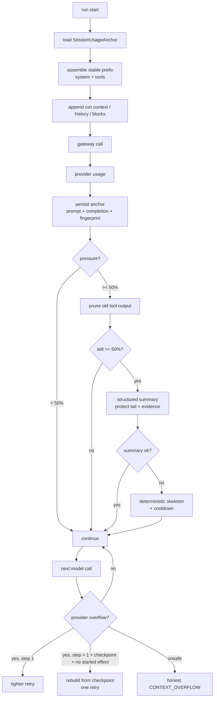

# W2 — Context Economics

W2 makes Eclipse use the model's real context budget instead of a 4-character
estimate, and makes long runs degrade gracefully instead of dying at the first
provider context error.

**Duration:** 3–4 engineer-weeks.  
**Flags:** `HARNESS_USAGE_ANCHOR` (on), `HARNESS_COMPRESSION_LADDER`
(shadow → on), `HARNESS_CONTEXT_GATE_PCT` (new, default 50).  
**Dependencies:** W1 gateway (landed) for real usage per attempt.

---

## 1. Goals

1. **Use provider reality.** Gate compaction on the provider's reported
   prompt/completion tokens plus a bounded estimate of what was appended since.
2. **Compact before the provider rejects.** 50% soft gate, 70% hard gate, 85%
   emergency gate; never wait for a 400.
3. **Compress in a ladder.** Prune old tool output first (no model), then a
   structured summary, then the deterministic skeleton.
4. **Preserve the tail and the evidence.** Never split an assistant/tool pair,
   never drop the last user turn, never compact the evidence ledger.
5. **Recover after step 1.** A provider overflow at step 8 can recover from the
   latest checkpoint when no unconfirmed effect exists.
6. **Keep the prompt cache warm.** The system/tool prefix is byte-stable; a
   changing runtime date, memory or skills block never sits before it.
7. **Keep the budget honest.** Unknown window or missing usage is an explicit
   `anchored: false`/`UNKNOWN`, never a fabricated count.

## 2. Non-goals

- No new tokenizer dependency in the default path. Provider usage first; the
  existing 4-char estimate remains the fallback.
- No second conversation store. The anchor is a small row keyed by session.
- No lossy "summary as truth". A summary is fenced, labelled, and never
  evidence.
- No change to tool results, prompts, finance facts or research claims.
- No semantic long-term memory (W5 owns that).

---

## 3. Current path

```mermaid
flowchart LR
  A["graph.execute_run"] --> B["_history_budget"]
  B --> C["compute_history_budget<br/>4 chars/token + 1024 reserve"]
  C --> D["_bounded_history<br/>20 turns / 40k chars"]
  D --> E["_dropped_context_block"]
  E --> F["compact_dropped<br/>skeleton + optional narrative"]
  F --> G["_assemble_run_messages"]
  G --> H["gateway / provider"]
  H --> I["provider 400 context overflow"]
  I --> J["_retry_with_tighter_budget<br/>only step <= 1"]
```



Problems:

- The budget guesses from characters; it does not use the provider's usage.
- History is capped by turns/chars, not by the actual remaining window.
- The model narrative is off by default (`history_compaction_model` absent), so
  most long runs get only the deterministic skeleton.
- `_retry_with_tighter_budget` refuses at step > 1, even with a clean checkpoint.
- The prompt head includes `runtime_context` before history, so a new run date
  invalidates the reusable prefix.
- Compression failures have no cooldown; a broken summary model is retried every
  turn.
- There is no prune stage: old tool output is compacted into prose instead of
  being paged out first.

---

## 4. Target path



---

## 5. Contracts

### 5.1 Usage anchor

`python/harness/context/usage_anchor.py` (new):

```python
@dataclass(frozen=True)
class UsageAnchor:
    session_id: str
    model_key: str                 # provider/model
    prompt_tokens: int
    completion_tokens: int
    anchor_message_id: str | None
    anchor_fingerprint: str        # sha256 of the anchored request tail
    appended_estimate: int
    context_length: int | None
    anchored: bool
    updated_at: str

class UsageAnchorStore:
    def get(self, session_id: str) -> UsageAnchor | None: ...
    def record(self, session_id: str, *, model_key: str, usage: Any,
               request_messages: list[Any], response: Any,
               context_length: int | None) -> UsageAnchor: ...
    def clear(self, session_id: str, reason: str) -> None: ...
```

Schema (additive, `agent-memory.db`):

```sql
CREATE TABLE IF NOT EXISTS SessionUsageAnchor (
  sessionId          TEXT PRIMARY KEY,
  modelKey           TEXT NOT NULL,
  promptTokens       INTEGER NOT NULL,
  completionTokens   INTEGER NOT NULL,
  anchorMessageId    TEXT,
  anchorFingerprint  TEXT NOT NULL,
  appendedEstimate   INTEGER NOT NULL,
  contextLength      INTEGER,
  anchored           INTEGER NOT NULL,
  updatedAt          TEXT NOT NULL
);
```

Rules:

- Record after every successful model call, from the W1 `Attempt`/provider
  usage. A failure records nothing; the previous anchor stays.
- Fingerprint is the last request message's id + content hash. A mismatch means
  the transcript changed (edit/rewind/compaction) and the anchor is stale.
- A model switch clears the anchor (`modelKey` mismatch).
- Compaction clears the anchor; the next response re-establishes it.
- If the provider omits usage, store `anchored=false` and keep the heuristic.
- One row per session; bounded and overwritten. No unbounded history.

### 5.2 Context budget v2

Extend `context_budget.ContextBudget`:

```python
anchor_used_tokens: int | None
anchor_anchored: bool
pressure: float | None          # used / window
gate: str                       # continue | soft | hard | emergency
```

`compute_history_budget` gains:

```python
anchor: UsageAnchor | None = None
gate_soft: float = 0.50
gate_hard: float = 0.70
gate_emergency: float = 0.85
```

Algorithm:

```
window = declared window or None
if window is None: inert budget (today's fallback)
if anchor valid and anchor.model_key == current model:
    used = anchor.prompt_tokens + estimate(messages since anchor)
else:
    used = measured_overhead + estimate(history + blocks)
usable = window - used - reserved_output
pressure = used / window
gate = continue | soft | hard | emergency
```

- `soft` (50%): prune old tool output; no model call.
- `hard` (70%): summary compaction before the next call.
- `emergency` (85%): summary + skeleton; if still over, refuse with
  `CONTEXT_EXHAUSTED` rather than send a doomed request.
- `unknown window`: inert, conservative constants, `gate=unknown`; no fabricated
  pressure.

### 5.3 Compression ladder

`python/harness/context/compression_ladder.py` (new):

```python
@dataclass(frozen=True)
class LadderResult:
    stage: str                  # prune | summary | skeleton | none
    messages: list[Any]
    dropped_turns: int
    pruned_tool_results: int
    summary_chars: int
    used_model: bool
    ok: bool
    reason: str
    cooldown_s: int

async def compress(
    messages: list[Any],
    *,
    budget: ContextBudget,
    request: RunRequest,
    emitter: RunEmitter,
    protect_turns: int = 8,
    protect_tool_results: int = 4,
) -> LadderResult: ...
```

Stages:

1. **Prune** (no model):
   - replace old tool results with
     `[pruned tool result: name, original_chars, output_id]`;
   - keep the last `protect_tool_results` and any result whose `data` carries an
     evidence/claim handle, a file read digest, an artifact, or a computation id;
   - never prune the last user turn or the current plan step.
2. **Summary** (bounded model):
   - protect the last `protect_turns` and the last user turn;
   - never split an assistant/tool pair;
   - structured prompt: decisions, facts with handles, open questions, files,
     tool outputs, next action;
   - 20 s timeout, 2k-char narrative ceiling; the existing
     `compaction.compact_dropped` is the implementation.
3. **Skeleton** (always succeeds):
   - existing deterministic skeleton; fenced, labelled, DATA;
   - no model call; no claim of a model summary.
4. **None**:
   - if no stage reduced the prompt, do not retry; return `ok=False` and let the
     caller decide (honest `CONTEXT_EXHAUSTED` or a tighter retry).

Cooldown:

- timeout/stall: 60 s → 300 s → 900 s;
- JSON/empty: 30 s;
- `/compact` and a provider-proven overflow ignore the cooldown once;
- persisted per session in a small `ContextCompressionState` row (session,
  failureClass, nextAttemptAt, consecutive).

### 5.4 Tail and evidence protection

`protect_tail(messages, *, turns=8, tool_results=4)`:

- keep the last N user/assistant turns;
- keep the last N tool results;
- keep any tool result with a handle (`evidence`, `citation`, `artifact`,
  `computation`, `record`, `file` digest);
- keep the current plan step and its last tool result;
- keep the skill/pruned-skill markers;
- never keep an orphan assistant tool call without its tool result.

The evidence ledger lives in `goals/` and is injected separately; it is never
part of the compaction payload. A summary cannot delete a claim.

### 5.5 Prompt plan v2

Extend `PromptPlan` with a cache plan:

```python
@dataclass
class PromptCachePlan:
    provider: str
    stable_segment_ids: tuple[str, ...]
    marker_count: int
    marker_kind: str            # anthropic_ephemeral | openai_prefix | none
```

Rules:

- **Stable tier:** system policy, agent identity, tool schema digest. Byte-stable
  for the entire run.
- **Context tier:** profile, skill manifest, lesson manifest, memory block,
  dropped/compacted block.
- **Volatile tier:** runtime context (date/time/run id) and the user turn.
- Move `runtime_context` **after** history. Today it sits at the top of
  `_assemble_run_messages`; that invalidates the cache across runs.
- Never mutate the system prompt mid-run. A skill index change is delivered as a
  one-shot user-role note, not a new system message.
- Anthropic: add `cache_control: {"type": "ephemeral"}` at the end of the stable
  block/tool schemas. OpenAI-compatible: prefix ordering only. Unknown provider:
  no marker.
- Emit `prompt.cache` with `cacheKey`, `stableChars`, `markerCount`, `kind`.

### 5.6 Any-step overflow recovery

`graph._retry_with_tighter_budget` currently refuses `step > 1`. Replace with:

```
if provider overflow and step > 1:
    require latest checkpoint
    require no RunEffect.state == "started" for this run
    require the checkpoint has a message cursor
    rebuild messages from checkpoint
    recompute budget with anchor + tighter margin
    retry ONCE
    emit context.recovered {fromStep, keptTurns, window}
else if step <= 1:
    existing tighter retry
else:
    honest CONTEXT_OVERFLOW
```

Safety:

- A rebuild from a checkpoint never re-runs a tool whose result is in the
  idempotency ledger or whose effect is `done`.
- An effect `started`/`unknown` blocks recovery; the operator must reconcile.
- The retry is at most one; a second overflow fails honestly.
- The original provider error is preserved in `detail` if the retry fails.

---

## 6. Message assembly target

```
[System: stable policy]
[System: tool guidance?  (stable)]
[history ...]
[System: profile snapshot]        <- context tier
[System: skill manifest]
[System: lesson manifest]
[System: memory block]
[System: compacted/dropped block]
[System: runtime context]         <- volatile, after history
[Human: current user turn]
```

The stable prefix is unchanged for the whole run. The runtime context is after
history so a new date never invalidates it. The user turn is last.

This is a change from today, where `runtime_context` is immediately after the
system prompt. The change is deliberate; tests must assert the new order and
that the stable prefix is byte-identical across steps.

---

## 7. Slices

### W2.1 — Usage anchor store

**Files:** `context/usage_anchor.py` (new), `persistence.py` or
`migrations.py`, `model_runtime/gateway.py` / `runtime.py` (record usage),
`service.py` (wire store).

**Change:** persist provider usage per session after every successful call.
No budget change yet.

**Acceptance:**

- A successful call writes one anchor row.
- A model switch clears it.
- A stale fingerprint is detected (`anchored=false`).
- A provider that omits usage stores `anchored=false`, not a fake count.
- No prompt/tool content is stored in the anchor.

**Tests:** `test_usage_anchor.py` (record, stale, model switch, no usage,
bounded schema).

### W2.2 — Anchor-driven budget gates

**Files:** `context_budget.py`, `graph.py` (`_history_budget`), tests.

**Change:** `compute_history_budget` accepts the anchor and returns pressure/gate.

**Acceptance:**

- A 200k window never sends a request above the window.
- 50/70/85 gates fire on real usage.
- Unknown window stays inert.
- Anchor mismatch falls back to the heuristic.
- `context.budget` event reports `anchored`, `used`, `pressure`, `gate`.

**Tests:** `test_context_budget.py`, new `test_context_gates.py`.

### W2.3 — Prune stage

**Files:** `context/compression_ladder.py` (new), `history.py`, `graph.py`.

**Change:** before summarising, replace old tool results with handles.

**Acceptance:**

- Old tool text is removed; output id/handle remains.
- Last N tool results and evidence handles are preserved.
- No model call for pruning.
- A short run changes nothing.

**Tests:** `test_context_prune.py` (ordering, handles, no-op).

### W2.4 — Summary ladder + cooldown

**Files:** `compaction.py`, `compression_ladder.py`, `graph.py`.

**Change:** prune → summary → skeleton; cooldown on failure; `/compact` forces.

**Acceptance:**

- A summary failure commits the skeleton with `usedModel=false`.
- A second failure does not retry within cooldown.
- `/compact` forces one attempt.
- A successful summary records chars/turns and preserves the tail.
- The summary is fenced and labelled DATA.

**Tests:** `test_history_compaction.py`, new `test_compression_ladder.py`
(success, timeout, stall, empty, cooldown, force).

### W2.5 — Any-step overflow recovery

**Files:** `graph.py` (`_retry_with_tighter_budget`), `run_lineage.py` (read
checkpoint), `run_effects.py` (started guard).

**Change:** recover at step > 1 only with a clean checkpoint and no started
effect.

**Acceptance:**

- Overflow at step 8 with a clean checkpoint resumes and completes.
- Overflow at step 8 with a started effect fails honestly.
- No tool is re-executed.
- One retry maximum; a second overflow fails with `CONTEXT_OVERFLOW`.

**Tests:** `test_context_overflow.py`, new `test_context_recovery_step8.py`.

### W2.6 — Cache-stable prompt tiers

**Files:** `prompt_segments.py`, `graph.py` (`_assemble_run_messages`),
`model_runtime/gateway.py` (cache markers), `observability/integration.py`.

**Change:** stable prefix, context blocks, volatile runtime/user; provider
markers.

**Acceptance:**

- The stable prefix bytes are identical across steps in a run.
- Runtime context is after history.
- A skill index change is a one-shot user note, not a system mutation.
- Anthropic markers appear where supported; no marker on unknown providers.
- `prompt.cache` event records key/marker count.

**Tests:** `test_prompt_segments.py`, new `test_prompt_cache_stability.py`,
`test_prompt_cache_markers.py`.

### W2.7 — Telemetry, flags, cleanup

**Files:** `config/flags.py`, `docs/harness/observability.md`,
`run_cost`/telemetry docs, `docs/harness/benchmarks.md`.

**Change:** `HARNESS_CONTEXT_GATE_PCT`, `HARNESS_COMPRESSION_LADDER` defaults,
events and dashboard fields; remove the old first-step-only comment.

**Acceptance:**

- One gate knob; documented.
- Events are mapped in the projector.
- A run report shows anchor/gate/ladder stage.
- No dead code path.

---

## 8. Fault matrix

| Case | Expected |
|---|---|
| Provider usage present | anchor used; pressure correct |
| Provider usage absent | `anchored=false`; heuristic; no fake count |
| Model switch | anchor cleared; new anchor after next call |
| Stale fingerprint (rewind/edit) | anchor ignored; heuristic |
| 50% pressure | prune only; no model call |
| 70% pressure | summary; tail preserved |
| 85% pressure | summary + skeleton; if still over `CONTEXT_EXHAUSTED` |
| Summary timeout | skeleton committed; cooldown armed |
| Summary stall twice | skeleton; cooldown 900 s |
| `/compact` during cooldown | forced attempt |
| Overflow at step 1 | tighter retry (existing) |
| Overflow at step 8 + clean checkpoint | one rebuild + retry |
| Overflow at step 8 + started effect | honest failure; no retry |
| Overflow at step 8 + no checkpoint | honest failure |
| Tool output huge | pruned to handle; full output remains via `read_tool_output` |
| Evidence handle in old result | never pruned |
| Stable prefix across steps | byte-identical |
| Runtime context after history | asserted |
| Anthropic marker | present when supported |
| Unknown provider marker | none; no failure |

---

## 9. Rollout

`HARNESS_USAGE_ANCHOR`:

1. shadow: record the anchor, keep the old budget.
2. on: gate on the anchor; compare overflow rate, tokens/task, latency.

`HARNESS_COMPRESSION_LADDER`:

1. shadow: compute the ladder decision, keep the old compaction.
2. on, prune only.
3. on, prune + summary.
4. remove the old path after two green weeks.

Canary 5% → 25% → 100% against the W1 baseline:

- context overflow rate
- tokens/task and cost/task
- p95 latency
- terminal correctness and resume success
- eval context/memory dimensions
- no evidence loss in finance/research tasks

Rollback:

- `HARNESS_USAGE_ANCHOR=off` returns to the 4-char estimate.
- `HARNESS_COMPRESSION_LADDER=off` returns to the skeleton-only path.
- The anchor table is additive; no migration rollback needed.

---

## 10. Risks

| Risk | Mitigation |
|---|---|
| Anchor stale after a rewind | fingerprint + clear on mismatch |
| Provider usage is wrong | bounded delta; clamp to window; event `anchored` |
| Over-compression loses evidence | protect tail/handles; never compact evidence ledger |
| Summary model cost/latency | opt-in model, 20 s timeout, cooldown |
| Prompt cache markers break a provider | capability-gated; no marker on unknown |
| Any-step recovery duplicates a tool | checkpoint + effect `started` guard + idempotency ledger |
| Unknown window | inert budget, conservative constants, honest event |
| New table growth | one row per session, overwrite |

---

## 11. Acceptance / exit criteria

W2 is complete when:

1. Provider usage is persisted per session; a missing usage block is
   `anchored=false`.
2. Budget gates use real usage when available and fall back honestly when not.
3. The 50/70/85 ladder is implemented: prune → summary → skeleton.
4. Compression failure has a persisted cooldown and `/compact` can force.
5. Tail, tool pairs and evidence handles are preserved; no tool is re-executed
   during overflow recovery.
6. Overflow at step > 1 recovers once from a clean checkpoint, or fails
   honestly.
7. The stable prompt prefix is byte-identical across steps; runtime context is
   after history; cache markers are provider-gated.
8. The fault matrix passes.
9. Full suite, offline evals, audit, conformance, SLO and tsc pass.
10. A W2 baseline artifact is committed with the same schema as W0/W1.

---

## 12. File map

| File | Change |
|---|---|
| `context/usage_anchor.py` | new: anchor model/store |
| `context/compression_ladder.py` | new: prune/summary/skeleton |
| `context_budget.py` | anchor input, pressure/gate |
| `history.py` | protect tail/tool results; use anchor budget |
| `compaction.py` | structured summary, cooldown, force |
| `prompt_segments.py` | cache plan, stable/context/volatile tiers |
| `graph.py` | budget/gate wiring, any-step recovery, message order |
| `model_runtime/gateway.py` | record usage anchor; cache markers |
| `persistence.py` / `migrations.py` | additive anchor/cooldown tables |
| `observability/integration.py` | context/cache events |
| `config/flags.py` | gate/ladder flags |
| `python/tests/test_*` | anchor, gates, prune, ladder, step-8 recovery, cache |

---

## 13. Relationship to W1 and W6

- **W1** supplies real provider usage and per-attempt records. W2 must not
  re-estimate what W1 already measured.
- **W6** owns checkpoint/effect integrity. W2's any-step recovery consumes the
  W6 checkpoint and effect ledger; it must not write run status directly.
- **W5** owns long-term memory. A compaction summary is short-term bridge text,
  never a memory record or evidence.

## 14. Open decisions

1. **Gate thresholds:** 50/70/85 as defaults, or per-agent profiles? Start with
   global; add profile overrides later.
2. **Summary model:** the run's model, or a cheap auxiliary model? The plan uses
   the existing `background_task` route; no new client.
3. **Token estimate:** keep 4-char fallback, or add a tokenizer dependency?
   Keep the fallback; provider usage is primary.
4. **Any-step recovery and side effects:** is "no `started` effect" too strict
   for a read-only run with a stale effect? The plan keeps it strict; an operator
   can reconcile and resume.
5. **Cache markers:** which providers beyond Anthropic? Add only where the
   provider API documents a marker; never guess.

---

## 15. Implementation status (2026-11-12)

### Landed

- **W2.1 usage anchor** — `python/harness/context/usage_anchor.py`
  (`SessionUsageAnchor`, `UsageAnchorStore`, `prepare_anchor`). The persisted
  shape is `modelKey`, `promptTokens`, `completionTokens`,
  `anchorFingerprint`, `anchorHistoryChars`, `contextLength`, `anchored`,
  `updatedAt` — one row per session, overwritten, no prompt/response text.
  `model_runtime/gateway.py` records it after a completed attempt; a model
  switch is detected by `modelKey` comparison at budget time.
- **W2.2 budget gates** — `context_budget.py` gains `anchor_used_tokens`,
  `anchor_anchored`, `pressure`, `gate` (`continue|soft|hard|emergency|
  unknown`). `HARNESS_CONTEXT_GATE_PCT` (default 50) sets the soft gate;
  hard/emergency follow at +20/+35 percentage points (70/85 by default).
  `graph._history_budget` accepts the anchor and the bounded appended-history
  estimate; an unknown window stays inert and reports `gate=unknown`.
- **W2.3/W2.4 compression ladder** — `python/harness/context/compression_ladder.py`
  owns the single decision point: prune (`pruning.prune_tool_messages`) →
  structured summary (`compaction.compact_dropped`) → deterministic skeleton,
  with the protected tail/last user turn/assistant-tool pairs and the persisted
  60/300/900 s cooldown (`compression_state.py`). `history.py` delegates turn
  compaction to `compact_turns`; `graph.py` uses the prune seam in the tool turn
  and `compress()` at a hard/emergency gate before the first call; overflow
  recovery uses it too. Shadow records the decision, `on` applies it.
- **W2.5 any-step recovery** — `run_recovery.recover_overflow_state` accepts
  only a completed-work checkpoint (`tool_results`/`replan`) whose effect ledger
  has no `started`/`unknown` entry. The checkpoint already carries every tool
  result and the resume idempotency ledger reuses it, so a tool-bearing step>1
  overflow recovers once without re-executing a tool. Emits
  `context.recovered {fromStep, keptTurns, stage}`.
- **W2.6 cache-stable prompt** — `runtime_context` sits after history and before
  the current user turn. `prompt_segments.PromptCachePlan` + `build_cache_plan`
  + `apply_cache_markers` add one Anthropic `ephemeral` marker to the stable
  system block, `openai_prefix` ordering for OpenAI-compatible providers, and
  NO marker elsewhere. `step.invoke_model_step` applies the marker immediately
  before the request; `prompt.cache` reports key/chars/marker count/kind.
- **Streaming overflow fix** — `model_stream.ainvoke_streaming` no longer treats
  a provider `CONTEXT_OVERFLOW` as "streaming unsupported" and silently
  re-invokes the model; the overflow reaches the graph's bounded recovery.
- **Retry** — `_retry_with_tighter_budget` moved to
  `python/harness/context/retry.py` (graph size ratchet) and re-exported from
  `graph.py`.

### Tests

`test_usage_anchor.py`, `test_context_gates.py`, `test_context_prune.py`,
`test_context_overflow.py`, `test_graph.py`, `test_history_bounded.py`,
`test_history_compaction.py`, `test_size_budget.py`,
`test_compression_ladder.py`, `test_prompt_cache_plan.py`,
`test_context_recovery.py`.

### Verification and baseline

- W2-focused suite: 159 passed (`compression_ladder`, `prompt_cache_plan`,
  `context_recovery`, `context_overflow`, `prompt_segments`, `graph`,
  `history_*`, `usage_anchor`, `context_prune`, `context_gates`,
  `model_gateway`, `step_retry`, `run_recovery`, `run_effects`, resume).
- Full suite on the shared tree: vitest 4,749 passed; pytest 10,718 passed,
  35 skipped. Seven pytest failures appeared during the 42-minute run because a
  concurrent stream was editing the same files mid-run; each failed file passed
  on immediate rerun (`test_flags`, `test_graph`, `test_phase_s_stabilization`,
  `test_public_api`, `test_run_effects`, `test_size_budget` — 30 passed).
- `npx tsc --noEmit`: clean.
- `npm run audit:agent`: 46 passed.
- `npm run gate:conformance`: 16/16.
- `npm run gate:slo`: 8/8.
- Live provider evals: NOT MEASURED (no provider configured; opt-in test exists).
- Baseline: `docs/harness/baselines/w2-8f79bed4-2026-11-12.json` / `.md`
  (74/74 terminal, 962 events, same schema as W0/W1).

### Closeout verification (2026-11-12, gaps closed)

- Targeted W2 suite (context budget/gates/prune/ladder/cache/overflow/recovery,
  history compaction/bounding, prompt segments, graph + agent node,
  observability): **164 passed**, 0 failed.
- `npx tsc --noEmit`: clean. Offline eval gates: **ALL PASS**.
- A full-tree `npm run test` rerun is currently red only on unrelated in-flight
  work in the same working tree (Python/TS size ratchets,
  `command-registry` confirm flag, two mixed-line-ending files, stale
  `docs/harness/tool-registry.json`). No W2 test fails.

