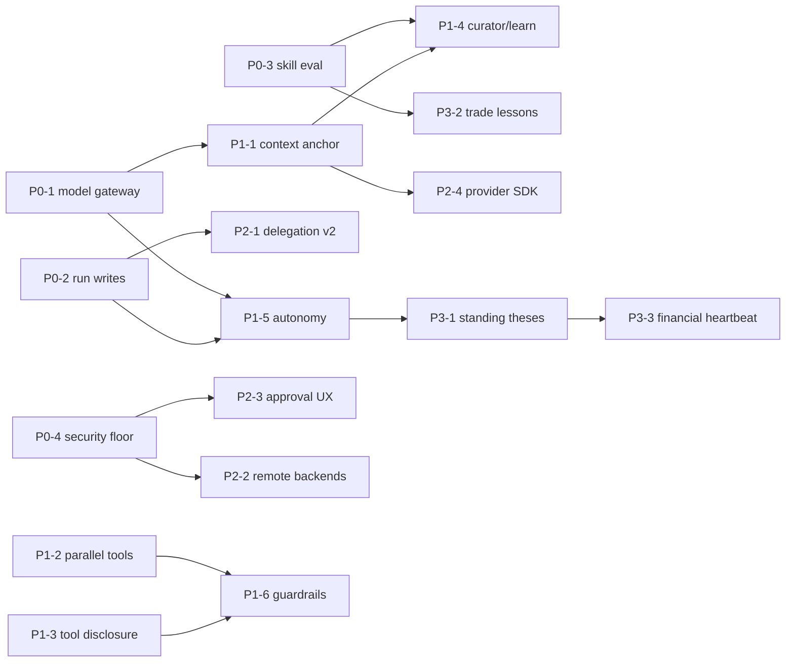

# Implementation Roadmap

> **Detailed companion:** `docs/harness/roadmap/hermes-inspired-improvement-plan.md`
> is the slice-by-slice engineering plan (interfaces, flags, tests, rollout and
> a 12-week schedule). This file stays the higher-level P0–P3 task list.

Priorities are defined by blast radius:

- **P0** — correctness, reliability, security or production readiness. Do these
  before adding capability.
- **P1** — intelligence, autonomy and usefulness; the agent becomes materially
  better at its job.
- **P2** — extensibility, developer experience and orchestration.
- **P3** — long-term differentiation.

Every task names the existing seam. No task is allowed to add a second loop,
scheduler, approval path, model client or skill store.

---

## P0 — Critical gaps

### P0-1. Route the live agent loop through a real model gateway

| Field | Detail |
|---|---|
| **Subsystem/files** | `python/harness/step.py` (`invoke_model_step`, `effective_call_timeout`), `python/harness/model_runtime/runtime.py` (`ModelRuntime.invoke`, `stream_for_graph`, `record_step`), `model_runtime/routing.py`, `model_runtime/health.py`, `model_runtime/errors.py`, `retry_policy.py`, `graph.py` (`agent_node`) |
| **Current** | `graph.py` calls `step.invoke_model_step` → `model_stream.ainvoke_streaming`; then `runtime.record_step`. `ModelRuntime.invoke` owns candidate selection, circuit breakers, rate limits, fallback and cost, but is **not called** by the graph. `stream_for_graph` exists (`runtime.py:632`) and is unused. Cross-provider fallback requires `HARNESS_MODEL_FALLBACK`; retry defaults disagree (`HARNESS_MODEL_RETRIES=1` vs `HARNESS_MODEL_ATTEMPTS=3`). |
| **Desired** | A single `ModelGateway.stream()` used by `step.py`: resolve candidates from `ModelRouter`; acquire provider rate limit; check model/provider circuit; call the provider with a streaming watchdog; classify errors into Eclipse's retry classes; on retryable failure, advance to the next candidate; persist one `ModelRequest`/usage row per physical attempt; expose `attempts`, `fallbackUsed`, `candidateTrace` in the step event. |
| **Dependencies** | None new. Use the existing `model_runtime` registry and `retry_policy`. Add `model_runtime/credential_pool.py` only if multi-key support is in scope (recommended). |
| **Migration** | Phase 1: shadow — call the gateway for eligibility/health decisions but keep the old call. Phase 2: route 100% behind `HARNESS_MODEL_GATEWAY=on` (default on after canary). Phase 3: delete the bypass. No schema change. |
| **Acceptance criteria** | (1) A 429/5xx/timeout on the primary produces exactly one fallback attempt and a completed run when a healthy fallback exists. (2) A 401/400 is not retried. (3) An open circuit skips the candidate. (4) `run.failed` carries the classified reason and the candidate trace. (5) Cost is attributed per attempt and `costUsd` is null when the model is unpriced. |
| **Automated tests** | `test_step_retry.py` (extend), `test_model_runtime.py`, new `test_model_gateway_failover.py` with a fake provider: 429→fallback, 500→retry→fallback, 401→no fallback, circuit open, timeout, stream stall, usage persisted, cost null. Add a conformance case to `evaluation/conformance`. |
| **Potential regressions** | Double-counted usage; fallback hiding a persistent auth failure; latency from health probes; a fallback model with a smaller context window (must re-check budget); cost spikes. Mitigate with one usage row per attempt, a `fallback` event, and a per-run cost cap. |

### P0-2. Fix run-kernel write-path correctness

| Field | Detail |
|---|---|
| **Subsystem/files** | `graph.py:884-890` (`modelSteps`/token writes), `graph.py:1197` (tool counter), `run_lease.py` (`fenced_update_run`), `graph.py:_write_checkpoint` (`689-702`), `run_lineage.py` (`save_messages`, `save_checkpoint`, `mark_tool_executed`), `run_effects.py`, `run_watchdog.py`, `events.py` (`RunEmitter._seq`) |
| **Current** | Terminal status is fenced; progress counters use plain `store.update_run`. Checkpoint and message writes are separate commits; checkpoint failures are swallowed; checkpoint `seq` is `MAX(seq)+1` outside a transaction; tool idempotency is recorded after execution; `RunEffects.begin/finish` are separate best-effort writes; the watchdog does not check a live lease; `RunEmitter._seq` is per instance and `HarnessEvent.id = evt_<run>_<seq>` can collide across emitters and be dropped. |
| **Desired** | (1) All run mutations go through `fenced_update_run` (progress and terminal). (2) `save_checkpoint` + `save_messages` commit in one transaction, or write a `checkpoint_intent` row first and mark it complete after; readers ignore incomplete intents. (3) `seq` is allocated inside `BEGIN IMMEDIATE` with a unique constraint. (4) `mark_tool_executed` is written **before** dispatch with a `started` state; after success it is `done`; after a crash it stays `started` and is treated as `unknown`. (5) `RunEffects.begin` is written in the same transaction as the pre-dispatch checkpoint; `finish` is guaranteed by a `try/finally` on normal unwind. (6) `find_stalled` skips runs with a live lease. (7) `RunEmitter` obtains a durable per-run sequence from the store, not an in-memory counter. |
| **Dependencies** | P0-1 not required, but do them in either order. |
| **Migration** | Additive schema only (`run_lineage._ensure_schema` / `migrations.py`). Existing rows without `seq` are backfilled on read. Old checkpoints remain readable. |
| **Acceptance criteria** | Crash after a checkpoint but before the model call resumes with the same message tail. Crash after `started` but before the tool returns resumes with `unknown`, never re-executes. Two emitters for one run produce no ID collision. A stale worker cannot write counters or terminal status. A lease-held run is never failed by the watchdog. |
| **Automated tests** | `test_run_lease.py`, `test_run_lineage.py`, `test_run_resume.py`, `test_run_effects.py`, `test_run_watchdog.py`, `test_events_bus.py`; add a fault-injection test that kills the process between checkpoint and dispatch; add a two-emitter concurrency test; add a stale-worker fencing test. |
| **Potential regressions** | A single transaction can hold the SQLite write lock longer; checkpoint latency; resume rejecting old payloads; tests that assume unfenced writes. Mitigate with a bounded transaction, a migration compatibility test, and a feature flag for the sequence allocator. |

### P0-3. Behavioural evaluation before a learned skill can be enabled

| Field | Detail |
|---|---|
| **Subsystem/files** | `skills/evaluation.py` (`evaluate_skill`, `_run_cases`, `promotion_gate`), `skills/draft.py` (`propose_draft`, `auto_draft_ready_candidates`, `evaluate_used_skills`), `self_improvement/self_modification.py` (`_enable_skill`, `run_once`), `skills/versioning.py` (`activate_version`), `evaluation/runner.py`, `evaluation/graders/` |
| **Current** | `evaluate_skill` checks manifest/schema/dependencies/permissions/tools/financial integrity/cases, but `_run_cases` only runs schema/input/output validators; it never executes the skill against a real task. `SelfModificationExecutor._enable_skill` enables `learned.*` skills whose **static** evaluation passed, default on, with a 7-day TTL, max 3 active, 10 actions/day. Outcome measurement starts only after 3 real uses. |
| **Desired** | Add an execution tier to `evaluate_skill`: run the skill's cases through `evaluation/runner.py` in an isolated environment; grade with existing graders (tool, state, artifact, citation, financial, honesty); require a minimum number of cases and a pass threshold; `promotion_gate` requires both static and execution tiers; `activate_version` refuses without an execution result; auto-enable requires the execution result and records the run id. |
| **Dependencies** | P1-4 (curator) not required. Uses existing `evaluation/` infrastructure and `tools/fixtures`. |
| **Migration** | Existing learned skills with only static evaluation remain enabled until TTL expiry, but new activations require execution. Add a `skills/eval` background job to backfill. |
| **Acceptance criteria** | A learned skill cannot be enabled without an execution run id and a pass verdict. A failing execution leaves the skill inert. A skill with no cases is `needs_review`, not `passed`. The TTL/caps still apply. |
| **Automated tests** | `test_skills_evaluation.py` (extend), `test_self_modification.py`, `test_skill_lifecycle_e2e.py`, new `test_skill_execution_gate.py` with a passing and failing skill; assert no enable on failure, enable on pass, and audit row. |
| **Potential regressions** | The execution tier is slower and costs model tokens; it may block legitimate skills with no cases. Mitigate with a case-authoring requirement for learned drafts, a cached evaluation fingerprint, and a `skip_execution` operator override with an audit entry. |

### P0-4. Expand the always-on safety floor and stop the shadow-only effect path

| Field | Detail |
|---|---|
| **Subsystem/files** | `security/floor.py`, `security/gateway.py`, `security/effect_tokens.py`, `security/approval.py`, `mcp/approvals.py`, `grants.py`, `code/policy.py` (`DENIED_PROGRAMS`, `PROTECTED_PATHS`), `code/shell.py`, `service.py:518` |
| **Current** | Effect tokens default to **shadow** (`HARNESS_EFFECT_TOKENS`), so a replayed/TOCTOU-widened call is logged but not blocked. The security gateway is constructed best-effort and a construction failure does not refuse the run. `code/shell.py` bypasses `code/sandbox.py` and has no tree kill. Approval TTL defaults to 900 s. Grants match by program/pattern string. |
| **Desired** | (1) Default `HARNESS_EFFECT_TOKENS=enforce` for effectful tools in production; keep shadow as an explicit development mode. (2) If the gateway cannot be constructed, the run refuses effectful calls (`SECURITY_UNAVAILABLE`) rather than continuing. (3) Route `code/shell.py` through the sandbox or delete it. (4) Add a hardline floor (root wipe, fork bomb, raw block-device write, shell-to-root) that no grant/YOLO can bypass. (5) Bind grants to a digest where possible and expire them. |
| **Dependencies** | None. Coordinate with P0-3 (security review). |
| **Migration** | Ship enforce in stages: shadow → warn-only for one release → enforce. Document the exact env var and the rollback. Do not change the default without an ADR. |
| **Acceptance criteria** | A replayed effect token is blocked in enforce. A missing gateway yields a clean refusal, not a run. A hardline command is blocked even with a grant. A shell command cannot bypass the sandbox profile. |
| **Automated tests** | `test_c6_effect_tokens.py`, `test_c6_escape.py`, `test_security_adversarial.py`, `test_security_core.py`, new `test_hardline.py`, new `test_shell_sandbox_parity.py`. |
| **Potential regressions** | Legitimate long-running tools whose token expires (raise TTL or refresh); a sandbox that is unavailable on a host (must refuse, not silently unsandbox); operator workflows that rely on YOLO. |

---

## P1 — Major improvements

### P1-1. Usage-anchored context management

| Field | Detail |
|---|---|
| **Subsystem/files** | `context_budget.py`, `history.py`, `compaction.py`, `prompt_segments.py`, `graph.py:_assemble_run_messages`, `_retry_with_tighter_budget`, `model_runtime/usage.py`, `persistence.py` (session fields) |
| **Current** | 4 chars/token; 20 turns/40k chars; deterministic skeleton compaction; model narrative off by default; overflow retry only at step ≤ 1; prompt cache key exists but no provider cache markers. |
| **Desired** | Persist a per-session usage anchor (provider prompt/completion + fingerprint + appended estimate). Gate compression on `anchor + delta`, not a whole-context guess. Keep a protected tail (tool pairs intact, last N turns). Compression ladder: prune old tool output → summarise → deterministic skeleton; cooldown 60/300/900 on failure; a second stall commits the deterministic fallback. Allow overflow recovery at any step if the run has a valid checkpoint and no unconfirmed effect. Add Anthropic/OpenAI cache markers where supported. |
| **Dependencies** | P0-1 for accurate usage from the gateway. |
| **Migration** | Additive columns/table; old sessions have no anchor and use the heuristic. Feature flag `HARNESS_USAGE_ANCHOR=on`. |
| **Acceptance criteria** | A 200k-token window is not exceeded; a long run compacts at ~50% and continues; a provider overflow at step 8 recovers once; a failed summary does not lose the transcript; cache hit rate improves in a live A/B. |
| **Automated tests** | `test_context_budget.py`, `test_context_overflow.py`, `test_history_compaction.py`, `test_prompt_segments.py`, new `test_usage_anchor.py`, new `test_compression_ladder.py`. |
| **Potential regressions** | Wrong anchor after a model switch; over-compression; losing tool results that a later verifier needs. Mitigate by clearing on model switch, protecting evidence/tool handles, and never compacting the evidence ledger. |

### P1-2. Parallel read-only tool execution

| Field | Detail |
|---|---|
| **Subsystem/files** | `graph.py:tools_node` (loop at `:997`), `tools.py` (`ToolRegistry.execute`), `run_effects.py`, `context_budget.py` |
| **Current** | Sequential `for call in calls`. |
| **Desired** | Partition a batch: `permission=="read"` and no effect → concurrent with `asyncio.Semaphore(HARNESS_TOOL_CONCURRENCY=6)`; effectful → in order; results always appended in the original call order; a per-batch deadline; cancellation cancels all outstanding; each call still gets policy/effect-token/timeout/output-bound. |
| **Dependencies** | P0-1 not required. |
| **Migration** | Flag `HARNESS_PARALLEL_TOOLS=on`; default off for one release, then on for read-only only. |
| **Acceptance criteria** | A 6-source retrieval turn completes in ~max(call) not sum(call); results are ordered; one failing call does not cancel the others unless the batch deadline expires; effectful calls remain serial; the tool budget counts each call once. |
| **Automated tests** | `test_graph.py` (tools node), `test_tools.py`, new `test_parallel_tools.py` (ordering, failure isolation, cancellation, budget, effect safety), a timing test with a 200 ms fake tool ×6. |
| **Potential regressions** | Provider rate limits; concurrent writes to a shared cache; nondeterministic event order. Mitigate with a semaphore, per-provider rate limits, and ordered event emission. |

### P1-3. Default-on tiered tool disclosure

| Field | Detail |
|---|---|
| **Subsystem/files** | `tool_surface.py` (`lazy_tool_surface`, `tool_search`, `tool_invoke`), `graph.py:1583`, `tools.py`, `agents.py` allowlists |
| **Current** | Lexical scoring, `HARNESS_LAZY_TOOLS` off, `tool_invoke` read-only, no tiered listing. |
| **Desired** | Enable when advertised schema tokens exceed a configurable fraction of context (e.g. 8%). BM25 over name/description/tags with stemming. Tiered listing: names → short descriptions → server/domain summary. `tool_invoke` may call effectful tools only through the normal policy path, never a bypass. A "no match" response names available sources. |
| **Dependencies** | None. Reuse `eclipse_memory/hybrid.py` BM25 ideas. |
| **Migration** | Flag `HARNESS_TOOL_DISCLOSURE=auto|on|off`, default `auto`. The agent's allowlist still constrains what can be invoked. |
| **Acceptance criteria** | Advertised tool tokens drop by ≥50% on a >1,000-tool surface; a tool named in a query is found in the top 5; an effectful discovered tool still asks for approval; a direct call by name works. |
| **Automated tests** | `test_tool_surface.py`, `test_tools.py`, new `test_tool_disclosure_bm25.py`, new `test_tool_invoke_effects.py`. |
| **Potential regressions** | The model fails to discover a tool; schema omission breaks a prompt; BM25 misses an exact name. Mitigate with exact-name boosting, an `available_sources` hint, and a config kill switch. |

### P1-4. Skill curator and `/learn`

| Field | Detail |
|---|---|
| **Subsystem/files** | `skills/registry.py`, `skills/authoring.py`, `skills/draft.py`, `skills/maintenance.py`, `skills/versioning.py`, `self_improvement/loop_health.py`, `jobs/` or `automation/` for cadence, `routers/skills.py` |
| **Current** | 91 skills; keyword matching; maintenance report but auto-archive off; no LLM consolidation; no `/learn` command. |
| **Desired** | (1) A curator job runs on idle/cadence, proposes merges/demotions as **inert** drafts with a diff, requires operator approval, never deletes, and preserves permissions/compliance text. (2) `/learn <source|conversation>` builds a draft via `authoring.py` + `draft.py`, then the behavioural gate (P0-3). (3) Usage-ranked + BM25 matching in `discover`. (4) A `/skill` slash invocation in chat that injects the skill body as a user message (not the system prompt). |
| **Dependencies** | P0-3 for safe enable; P1-1 for context budget. |
| **Migration** | Curator off by default for one release; `skills.curator.mode=dry_run` writes a report only. Operator enables `propose`. |
| **Acceptance criteria** | A dry run produces a merge proposal and changes nothing. An approved merge creates a new version, archives the old one, and is reversible. `/learn` never enables a skill automatically. Matching returns a relevant skill for a paraphrase. |
| **Automated tests** | `test_skills_registry.py`, `test_skill_lifecycle_e2e.py`, `test_skill_authoring.py`, new `test_skill_curator.py` (dry-run, approval, rollback, frozen compliance text), new `test_skill_matching.py`. |
| **Potential regressions** | Curator merges distinct compliance rules; LLM cost; a bad merge pollutes the library. Mitigate with inert diffs, frozen fields, no deletion, and an operator gate. |

### P1-5. Goal / loop / heartbeat autonomy engine

| Field | Detail |
|---|---|
| **Subsystem/files** | New `python/harness/autonomy/goal_runtime.py`, `loop_runtime.py`; reuse `goals/runtime.py`, `goals/ledger.py`, `goals/verifiers.py`, `tasks/`, `jobs/`, `automation/`, `routers/sessions.py`, `routers/runs.py`, `ChatSession`/`Goal` persistence |
| **Current** | No in-session goal judge, loop or heartbeat. Jobs/automation/tasks exist but are user-configured, not conversational. |
| **Desired** | `/goal` sets objective + contract + gates + budget; after a terminal answer, deterministic gates run first, then a cheap judge returns `done|continue|blocked|wait`; `continue` starts a new run with a continuation prompt; `wait` parks on a process/condition; budget exhaustion pauses. `/loop` runs a prompt on a fixed/self-paced cadence in the same session; `/heartbeat` is an idle-only same-session turn. Persist in the session/goal store; survive `/resume` and compression. |
| **Dependencies** | P1-1 (context), P0-1 (cheap auxiliary model), existing `tasks`/`jobs`. |
| **Migration** | New tables only; no change to existing runs. Feature flag `HARNESS_AUTONOMY=on` for the commands; default on after a canary. |
| **Acceptance criteria** | A goal with a failing test gate does not complete; a goal with a passing gate + judge `done` completes; a blocked goal pauses with a reason; a loop stops at `--times`/`--until`; a heartbeat never fires mid-run; cancellation is immediate; resume restores the goal. |
| **Automated tests** | New `test_goal_runtime.py` (gate pass/fail, judge continue/done/blocked/wait, budget), `test_loop_runtime.py` (cadence, caps, self-pacing), `test_heartbeat.py` (idle-only, coalescing), `test_autonomy_resume.py`. |
| **Potential regressions** | Runaway spend; a judge that says "continue" forever; a goal that fights a user message. Mitigate with turn/token budgets, `maxTicks`, user input priority, and a kill switch. |

### P1-6. Tool guardrails

| Field | Detail |
|---|---|
| **Subsystem/files** | `graph.py:tools_node`, `tools.py`, `observability/anomaly.py`, `recovery/hotpath.py` |
| **Current** | Per-turn duplicate suppression (`_stable_key`), recovery nudge, hard tool budget, anomaly detector. |
| **Desired** | Signature = canonical tool name + normalized args + result hash. Halt after 3 identical calls, a cycle of period ≤ 4, or N consecutive failures with no state change. Repeatable tools (`read_tool_output`, pollers) are exempt. Halt produces a model-readable message and a `tool.guardrail_halt` event; operator can reset. |
| **Dependencies** | None. |
| **Migration** | Flag `HARNESS_TOOL_GUARDRAILS=warn|halt`; start in `warn`, then `halt`. |
| **Acceptance criteria** | A loop that repeats the same failing call stops with a clear message at 3; a legitimate retry with changed args is allowed; a poller is not halted; the run remains resumable. |
| **Automated tests** | New `test_tool_guardrails.py` (identical, cycle, failure streak, repeatable exemption, reset), extend `test_graph.py`. |
| **Potential regressions** | False positives on legitimate repeated reads; a halt that leaves a child running. Mitigate with the exemption list and a cancellation sweep. |

### P1-7. File checkpoints and `/rollback`

| Field | Detail |
|---|---|
| **Subsystem/files** | New `code/checkpoints.py`; `code/fs/operations.py`, `code/fs/editing.py`, `code/fs/transactions.py`, `git/` safety, `code/tools.py`, `routers/code.py` |
| **Current** | Worktrees, git safety, fs transactions; no user-facing snapshot/restore of agent edits. |
| **Desired** | A single bare shadow repo under `.black-eclipse/checkpoints`; snapshot at most once per project per turn before `write_file`/`patch`/destructive terminal; list/diff/restore by checkpoint id; restore is operator-approved, takes a pre-restore snapshot, and never touches `.git`, databases, `.env`, or ignored roots. |
| **Dependencies** | System `git`. No new library. |
| **Migration** | Opt-in `HARNESS_FILE_CHECKPOINTS=on`, default off for one release. No schema change. |
| **Acceptance criteria** | A bad edit can be listed, diffed and restored; a restore preserves unrelated hand edits by default; a full restore is explicit; the store is size-capped and pruned. |
| **Automated tests** | `test_code_fs_*`, `test_git_safety.py`, new `test_file_checkpoints.py` (snapshot, dedupe, restore, protected paths, size cap). |
| **Potential regressions** | Disk growth; snapshot latency on large repos; restoring a file that a later tool depends on. Mitigate with excludes, size caps, and a pre-restore snapshot. |

---

## P2 — Advanced capabilities

### P2-1. Delegation v2 (async completion, schema, steering, worktrees)

| Field | Detail |
|---|---|
| **Subsystem/files** | `delegation.py`, `delegation_tools.py`, `spawn/service.py`, `spawn/board.py`, `fabric/`, `a2a/`, `code/worktree.py`, `routers/runs.py` |
| **Current** | Synchronous `delegate`; max 4 children; deterministic claim merge; Fabric jobs; blackboard; A2A; no async completion, no schema repair, no steering. |
| **Desired** | `delegate_async` returns a Fabric job id; `delegate_status`, `delegate_steer`, `delegate_cancel`, `delegate_result`; `output_schema` validated by the parent with one bounded repair turn; optional per-child worktree; completion delivered as a durable event; children never inherit operator grants. |
| **Dependencies** | P0-2 for durable job state; P1-5 for event delivery. |
| **Migration** | New tools; keep `delegate` as a synchronous wrapper. Flag `HARNESS_ASYNC_DELEGATION`. |
| **Acceptance criteria** | A parent can continue while 3 children run; results arrive once; a schema miss gets one repair; a cancel stops the child at a safe boundary; a child cannot escalate permissions. |
| **Automated tests** | `test_delegation_*`, `test_c5_spawn.py`, `test_fabric_*`, new `test_delegate_async.py`, `test_output_schema_repair.py`, `test_delegate_steer.py`. |
| **Potential regressions** | Orphan children; duplicate completion; budget leakage. Mitigate with Fabric leases, idempotency keys, and total token caps. |

### P2-2. Remote terminal backends

| Field | Detail |
|---|---|
| **Subsystem/files** | `terminal/manager.py`, `terminal/process_manager.py`, `terminal/runtimes.py`, `code/sandbox.py`, `security/profiles.py`, `plugins/manifest.py` |
| **Current** | Local, Docker, AppContainer; no SSH/serverless. |
| **Desired** | A `TerminalBackend` protocol with capability declaration (network, mounts, kill semantics); implement SSH first, then one serverless backend; every backend must satisfy a declared sandbox profile or refuse; no implicit host mounts; process ownership still tracked. |
| **Dependencies** | P0-4 sandbox/security. |
| **Migration** | Backends registered as plugins; default remains local. |
| **Acceptance criteria** | A remote command runs only with an explicit profile; a host path is not mounted implicitly; a remote process can be killed; the audit records the backend and host. |
| **Automated tests** | New `test_terminal_backends.py` with a fake SSH transport; `test_c6_profiles.py`; `test_terminal_tools.py`. |
| **Potential regressions** | Credential leakage; orphan remote processes; mismatch between local and remote paths. Mitigate with secret scoping, remote process ids, and path mapping. |

### P2-3. Approval UX (scopes, smart approval, cards)

| Field | Detail |
|---|---|
| **Subsystem/files** | `security/approval.py`, `mcp/approvals.py`, `grants.py`, `security/floor.py`, `src/components/chat/approval-card.tsx`, `routers/security.py` |
| **Current** | Digest-bound single-use approvals, standing grants, approval card. No session/permanent scope, no smart low-risk approval. |
| **Desired** | Scopes `once|session|permanent` with expiry and audit; smart approval for low-risk read-only commands via a cheap model, deny-by-default; approval cards show the exact args, effect, and digest; unattended contexts deny. |
| **Dependencies** | P0-4. |
| **Migration** | New scope field; existing approvals default `once`. |
| **Acceptance criteria** | "Allow for session" does not approve a different digest; a permanent grant is revocable; a smart-approved command is logged with the model reason; an unattended run denies. |
| **Automated tests** | `test_security_core.py`, `test_mcp_approvals.py`, new `test_approval_scopes.py`, `test_smart_approval.py`. |
| **Potential regressions** | Over-broad grants; a smart model approving a destructive command. Mitigate with a hardline floor, a read-only allowlist, and an audit. |

### P2-4. Memory/context provider SDK

| Field | Detail |
|---|---|
| **Subsystem/files** | `memory_providers/protocol.py`, `registry.py`, `routing.py`, `reliability.py`, `plugins/manifest.py`, `context_budget.py` |
| **Current** | Native + MCP memory providers; external search off by default; no context-engine protocol. |
| **Desired** | Public `MemoryProvider` + `ContextEngine` protocols; register in the plugin manifest; native memory remains authoritative; external results fenced and never promoted; a context engine can be selected per agent. |
| **Dependencies** | P1-1. |
| **Migration** | Additive; existing providers keep working. |
| **Acceptance criteria** | A third-party provider can be installed, enabled, and queried; its results are labelled unverified; it cannot write without explicit approval; a context engine can be selected without changing the kernel. |
| **Automated tests** | `test_memory_providers.py`, `test_memory_reliability.py`, new `test_context_engine_plugin.py`. |
| **Potential regressions** | Prompt poisoning; latency; a provider that hangs. Mitigate with timeouts, a circuit breaker, and fencing. |

---

## P3 — Long-term differentiation

### P3-1. Evidence-aware standing investment theses

| Field | Detail |
|---|---|
| **Subsystem/files** | `goals/`, `autonomy/goal_runtime.py`, `research/`, `advisory/`, `portfolio/`, `automation/monitors.py`, `prisma/schema.prisma` (`Thesis` already exists in the front door) |
| **Current** | Investment Thesis Tracker exists in TS (`src/lib/theses/`) with versioned theses and deterministic evidence impact. The agent does not run a thesis as a standing goal. |
| **Desired** | A thesis can be attached to a goal; each tick re-runs the evidence mandate, compares new evidence to the thesis assumptions, and reports a deterministic impact; the agent updates the thesis only through an operator-approved revision. |
| **Dependencies** | P1-5, P1-1, existing research/advisory. |
| **Migration** | Additive link between `Thesis` and `Goal`; no rewrite. |
| **Acceptance criteria** | A new filing triggers a re-evaluation; the impact is deterministic; the thesis original hypothesis is never silently rewritten; a contradiction is surfaced. |
| **Automated tests** | New `test_thesis_goal.py`, `test_thesis_evidence_impact.py`; extend `src/lib/theses/analysis.test.ts`. |
| **Potential regressions** | Notification spam; stale evidence; hallucinated impact. Mitigate with change detection, freshness checks, and deterministic impact. |

### P3-2. Trade-outcome learning into the agent learning loop

| Field | Detail |
|---|---|
| **Subsystem/files** | `trade_learning/`, `eclipse_memory/mistakes.py`, `skills/learning.py`, `research/learning.py`, `graph_runtime/trade_learning_nodes.py` |
| **Current** | Trade learning is deterministic and workflow-node-only; it drafts inert RSL candidates but is not part of ordinary chat learning. |
| **Desired** | A resolved trade review can produce a **lesson candidate** (not a live rule) that enters the same lesson pipeline as other mistakes; only an operator can adopt it; the lesson is injected only when a trade-planning cue matches. |
| **Dependencies** | P0-3, P1-4, P1-5. |
| **Migration** | Add a bridge; do not move the trade-learning store. |
| **Acceptance criteria** | A revenge-trade pattern produces a candidate; it is not auto-enabled; when adopted, it appears in a later trade-planning run; the outcome is tracked. |
| **Automated tests** | `test_trade_learning.py`, new `test_trade_lesson_bridge.py`, `test_lesson_feedback.py`. |
| **Potential regressions** | Overfitting to a few trades; a lesson that harms returns. Mitigate with recurrence thresholds, holdout evaluation, and operator adoption. |

### P3-3. Financial heartbeat and proactive research

| Field | Detail |
|---|---|
| **Subsystem/files** | `autonomy/loop_runtime.py`, `automation/monitors.py`, `market/streaming.py`, `research/coordination.py`, `advisory/cadence.py`, `portfolio/` |
| **Current** | Cadence loop, monitors, alerts; no agent heartbeat that decides whether a change is worth research. |
| **Desired** | A heartbeat watches a portfolio/watchlist/thesis; deterministic conditions (price move, new filing, rating change, spread) gate whether a model turn runs; no change ⇒ no LLM call; a change ⇒ bounded research with evidence and a disclosure. |
| **Dependencies** | P1-5, P3-1. |
| **Migration** | Opt-in per watchlist/thesis. |
| **Acceptance criteria** | An idle heartbeat costs zero model tokens; a real change produces a cited brief; duplicate alerts are coalesced; the user can pause it. |
| **Automated tests** | New `test_financial_heartbeat.py`, `test_alert_coalescing.py`; extend `test_automation_engine.py`. |
| **Potential regressions** | False positives; cost; notification fatigue. Mitigate with conditions, debounce, and a per-day cap. |

### P3-4. External benchmark and skill-marketplace federation

| Field | Detail |
|---|---|
| **Subsystem/files** | `evaluation/adapters/`, `evaluation/compare_release.py`, `plugins/registry_client.py`, `skills/install.py` |
| **Current** | External adapters are gated and a missing download is `unavailable`; no SWE-bench/GAIA/tau-bench in the scorecard; plugin registry is local-first. |
| **Desired** | A stable adapter contract for external suites, with contamination checks and an honest `unavailable`; a signed skill/plugin index with versions and provenance; Eclipse can consume a public catalog without trusting it. |
| **Dependencies** | P0-3, P2-4. |
| **Migration** | Adapters opt-in; catalog entries always scanned and signed. |
| **Acceptance criteria** | An external suite can be run and reported without contaminating the corpus; an unsigned catalog entry is refused; a signed entry is reproducible. |
| **Automated tests** | `test_evaluation_external.py`, `test_c8_external.py`, `test_plugin_signing.py`, new `test_catalog_federation.py`. |
| **Potential regressions** | Benchmark overfitting; supply-chain risk. Mitigate with split controls, signatures, and review. |

---

## Dependency graph

---

## Suggested sequencing (90 days)

Weeks 1–3: P0-1, P0-2 (both behind flags, offline eval + live canary).
Weeks 3–5: P1-1, P1-2.
Weeks 5–7: P0-3, P0-4, P1-6.
Weeks 7–9: P1-4, P1-5.
Weeks 9–11: P1-7, P2-1.
Weeks 11–13: P1-3, P2-3, then P3-1.

P2-2, P2-4 and P3-2/P3-3 start only when the P0/P1 path is green on the
offline and live evaluation tiers for two consecutive weeks.

---

## Global acceptance gates

A task is not done until:

1. `npm run test` and `npx tsc --noEmit` pass from `Black-Eclipse-site/`.
2. The new tests listed above pass, including at least one fault-injection or
   adversarial case.
3. The offline evaluation gate (`evaluation/gate.py` via `npm run test:evals`)
   does not regress.
4. `npm run audit:agent` passes (44 checks) and the conformance gate passes.
5. The change has a kill switch and a documented rollback.
6. The change has a `CHANGELOG.md` entry and, if it alters a contract or
   architecture, the owning doc is updated.
