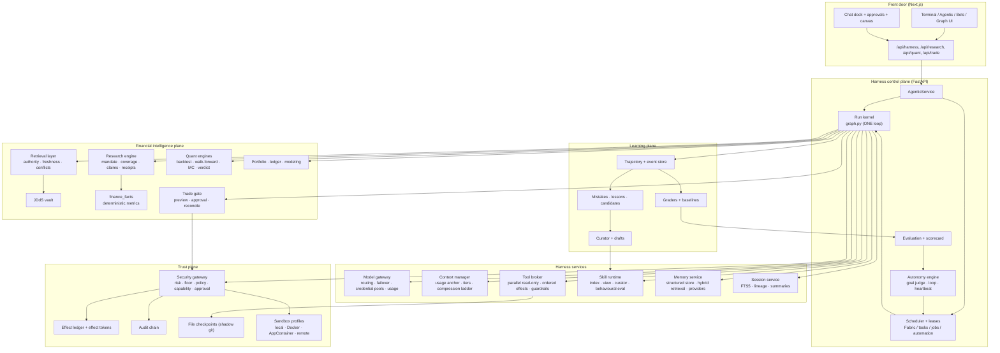
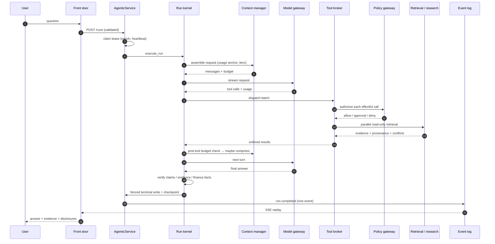
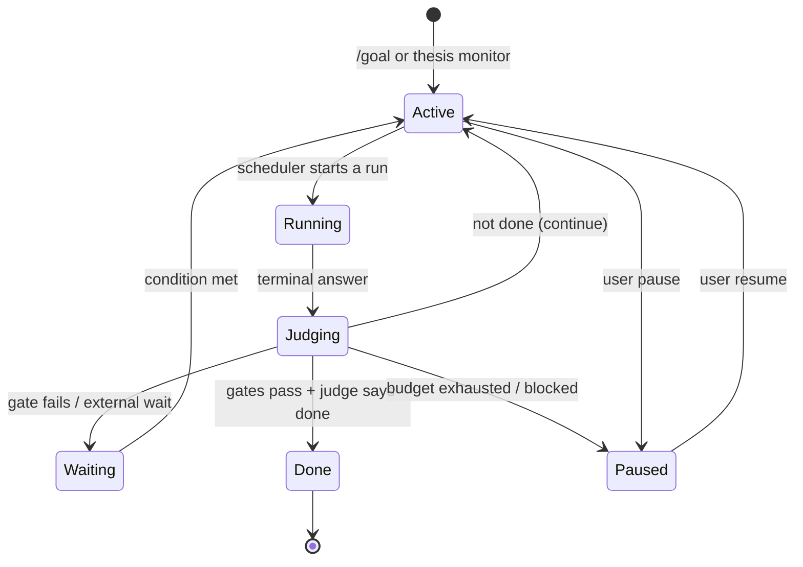
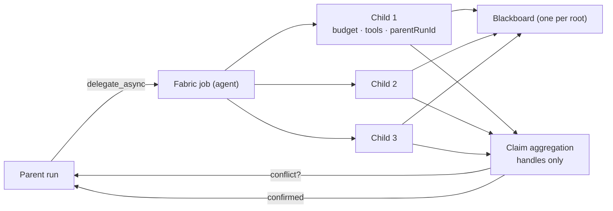
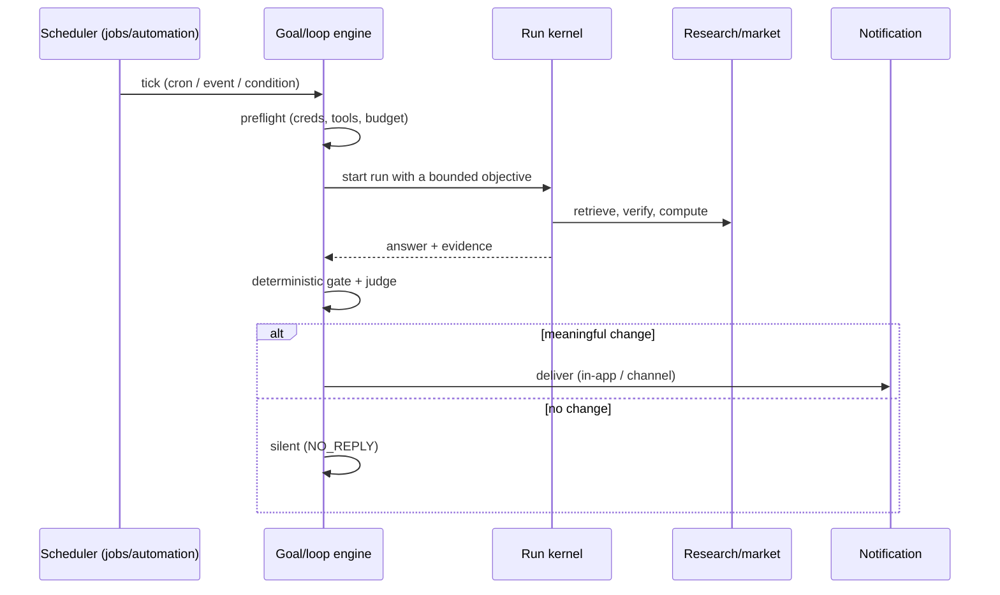

# Target Architecture

This is the proposed future shape of Eclipse. It is an **extension**, not a
rewrite: the run kernel, policy gateway, evidence model, financial engines and
product surfaces stay. The changes are concentrated in the harness layer —
model gateway, context manager, tool execution, autonomy, learning — plus two
new safety surfaces (file checkpoints, behavioural skill evaluation).

---

## Design principles

1. **One loop, one run kernel.** Keep `harness/graph.py` as the only agent
   loop. New autonomy features (goals, loops, heartbeats) start *runs*; they do
   not create a second loop.
2. **One policy seam.** Every effectful operation still goes through
   `security/gateway.py`. A new capability is not allowed to add its own
   approval path.
3. **One event log.** Every new subsystem publishes to `events.py` /
   `event_system`; observability, SSE and evaluation read the same events.
4. **Domain engines are deterministic and model-free.** Models plan, explain
   and route; Python computes. No new financial statistic may be computed in a
   prompt, a skill, or a plugin.
5. **Every model-facing claim has a handle.** Evidence, citations,
   computations, artifacts and records are the only things a final answer may
   assert as fact.
6. **Fail closed, degrade honestly.** `UNAVAILABLE`, `UNKNOWN`, `priced:false`
   and `interrupted` are first-class states. No fabricated zero, no silent
   fallback, no "looks done".
7. **Adopt on seams, not beside them.** A Hermes idea lands in an existing
   Eclipse module; if it needs a new store or scheduler, it needs an ADR first.

---

## Target component map



The important edges:

- The **model gateway** sits between the kernel and every provider. The kernel
  never calls a provider SDK directly.
- The **context manager** owns the message budget and compression; the kernel
  asks it for a request, not for a turn count.
- The **tool broker** owns concurrency, ordering, validation, output bounding
  and guardrails; it calls the policy gateway for every effectful call.
- The **autonomy engine** is a *client* of the scheduler and the kernel. It has
  no loop of its own.
- The **learning plane** consumes run events; it never mutates a run.

---

## Execution flow 1 — interactive financial research run



Changes relative to today:

- `C` is real: provider usage anchor, stable prompt tiers, compression ladder.
- `T` runs read-only calls concurrently and effectful calls in order.
- `M` owns failover and credential rotation, not `step.py` alone.
- `K` always verifies at the answer seam (already true for code/finance goals,
  but not uniformly enforced).

---

## Execution flow 2 — standing investment thesis (goal)



The goal record stores: objective, completion contract (outcome, verification,
constraints, boundaries, stop_when), deterministic gates, turn budget, used
turns, last verdict, and evidence handles. The judge is a cheap auxiliary model
*plus* deterministic gates; a gate failure short-circuits the judge. The
continuation is a **new run** with the same goal id and a generated continuation
prompt; the goal is not a long-lived process.

This uses `tasks/` for the run, `jobs/` or `automation/` for the schedule,
`goals/` for the ledger, and `evaluation/` for gate results where applicable.
No new scheduler.

---

## Execution flow 3 — delegated parallel research



Rules preserved from today:

- depth ≤ 2, fanout ≤ 8, total child tokens ≤ 120k, per-child timeout.
- children inherit user/workspace/session, never operator/autonomy.
- the parent merges only re-checkable claims; contradictions are surfaced.
- a child that is interrupted is `unknown`, never silently retried.

New:

- `output_schema` with one bounded repair turn.
- `delegate_status` / `delegate_steer` / `delegate_cancel` over Fabric job ids.
- optional per-child git worktree.
- completion is delivered as a durable event; no polling.

---

## Execution flow 4 — scheduled monitor / heartbeat



A heartbeat is an idle-only turn in the *same* session; a cron job is a fresh
session. Eclipse should keep that distinction. The "no busywork" rule is a
prompt instruction plus a deterministic no-change check, not a model promise.

---

## What stays, changes, and is new

### Stays unchanged (protect these)

| Component | Why |
|---|---|
| `graph.py` run kernel shape | One loop, one deadline, one retry vocabulary; already correct. |
| `run_lease.py`, `run_lineage.py`, `run_effects.py` | Lease/fencing/checkpoint/effect semantics are Eclipse's moat. |
| `security/gateway.py` + `security/floor.py` + `security/audit.py` | Policy chain and hash-chain audit. |
| `retrieval/`, `market/verification.py`, `finance_facts/` | Authority, conflict, provenance, deterministic metrics. |
| `research/` mandate → coverage → claims → receipt | The evidence contract. |
| `quant/` engines and `verdict.py` | Deterministic quant with grade caps. |
| `portfolio/`, `ledger/`, `modeling/` | Books of record. |
| `trade/` approval/reconcile | The execution gate. |
| `evaluation/` + `observability/` | Measurement and audit. |
| JDdS read-only vault boundary | Licensing and provenance. |

### Refactor

| Component | Change |
|---|---|
| `step.py` + `model_runtime/` | Make the graph use the runtime; one retry policy; one usage ledger; streaming watchdog. |
| `context_budget.py` + `history.py` + `compaction.py` | Usage anchor, tiered prompt plan, compression ladder, any-step overflow recovery with safety. |
| `graph.py:tools_node` + `tools.py` | Parallel read-only batch, ordered effects, guardrail controller, default tool search. |
| `events.py` | Durable sequence allocator per run (not per emitter); one writer; no collisions. |
| `run_watchdog.py` | Lease-aware; never fail a run held by a live lease. |
| `graph.py` counter writes | Use `fenced_update_run` for progress counters, not only terminal status. |
| `_write_checkpoint` | Atomic message + checkpoint commit (one transaction or a two-phase marker). |
| `run_effects` | Write `started` before dispatch in the same transaction as the checkpoint; guarantee `finish` on normal unwind. |
| `skills/evaluation.py` | Add an execution tier; static checks become a pre-filter. |
| `eclipse_memory/retrieval.py` | Wire BM25/hybrid; add periodic consolidation. |
| `session_index.py` | Add browse/scroll shapes; trigram for CJK. |
| `code/shell.py` | Route through `code/sandbox.py`; tree kill. |

### Extend

| Component | Extension |
|---|---|
| `goals/` | Goal contract, judge, deterministic gates, resume. |
| `tasks/` / `jobs/` | Autonomy engine as a client; no new scheduler. |
| `spawn/` / `delegation.py` | Async status/steer/cancel, `output_schema`, worktrees. |
| `skills/` | Curator, `/learn`, usage-ranked matching. |
| `memory_providers/` | Public provider SDK; context-engine protocol. |
| `plugins/` | Register the new provider types; keep signing/sandbox. |
| `terminal/` | Remote backend interface (SSH first). |
| `artifacts/` | File checkpoint linkage; rollback restores artifacts. |
| `observability/` | Span attributes for goal/loop/delegation; SLOs for autonomy. |

### Replace

| Component | Replacement |
|---|---|
| `code/shell.py` direct subprocess path | `code/sandbox.py` only. |
| Ad-hoc HTTP clients in domain modules | `retrieval/` / `research/` clients with authority and rate limits. |
| Any duplicated schedule path | One owner: `jobs/` for durable cron, `automation/` for event/condition, Graph Studio schedules delegate to the same engine. |
| `HARNESS_MODEL_RETRIES` vs `HARNESS_MODEL_ATTEMPTS` | One retry policy with one env prefix. |

### New

| Component | Purpose |
|---|---|
| `model_runtime/credential_pool.py` | Multi-key rotation, cooldown, health. |
| `model_runtime/stream_gateway.py` | Candidate selection + failover + watchdog around `step`. |
| `context/usage_anchor.py` | Provider usage + appended delta; persisted per session. |
| `context/compression_ladder.py` | Gate → prune → summarise → deterministic fallback; cooldown. |
| `tools/guardrails.py` | Identical-call/cycle/stall detection; controlled halt. |
| `autonomy/goal_runtime.py` | Goal contract, judge, gates, continuation. |
| `autonomy/loop_runtime.py` | Fixed/self-paced loop and heartbeat. |
| `skills/curator.py` | Idle consolidation with inert diffs and rollback. |
| `skills/execution_eval.py` | Behavioural evaluation before enable. |
| `code/checkpoints.py` | Shadow-git snapshots and restore. |
| `memory/hybrid.py` | Wire the existing BM25 into retrieval. |
| `security/hardline.py` | Expanded always-on floor. |
| `terminal/backends/` | SSH + one serverless backend. |

### Integrate from open source

- **BM25/stemming:** Eclipse already has a BM25 implementation in
  `eclipse_memory/hybrid.py`; finish it rather than adding a dependency.
- **Git:** use the system `git` binary for shadow checkpoints; no library.
- **Cron:** keep Eclipse's `jobs/cron.py`; do not add `croniter`.
- **Token counting:** prefer provider usage; for local estimation keep the
  existing 4-char heuristic as a fallback, optionally add a tokenizer later.
- **Tracing:** keep Eclipse's OTLP exporter; do not adopt a second telemetry
  stack.

---

## Data contracts to add

### Usage anchor

```json
{
  "sessionId": "…",
  "model": "provider/model",
  "promptTokens": 41230,
  "completionTokens": 812,
  "anchorMessageId": "…",
  "anchorFingerprint": "sha256:…",
  "appendedEstimate": 1400,
  "contextLength": 200000,
  "updatedAt": "…"
}
```

Rules: an anchor is valid only while the transcript prefix still matches the
fingerprint; a model switch clears it; compaction clears it; a provider that
omits usage falls back to the estimate and marks `anchored: false`.

### Goal record

```json
{
  "goalId": "…",
  "rootRunId": "…",
  "objective": "…",
  "contract": {
    "outcome": "…",
    "verification": ["command:…", "artifact:…"],
    "constraints": ["…"],
    "boundaries": ["…"],
    "stopWhen": ["…"]
  },
  "gates": [{"id": "…", "command": "…", "timeoutS": 300, "retries": 3}],
  "budget": {"maxTurns": 20, "usedTurns": 0, "maxTokens": 500000},
  "status": "active|running|waiting|done|paused|failed",
  "lastVerdict": {"verdict": "continue", "reason": "…", "evidence": ["…"]},
  "createdAt": "…",
  "updatedAt": "…"
}
```

### Tool guardrail decision

```json
{
  "tool": "get_historical_prices",
  "signature": "sha256:…",
  "rule": "identical_call|cycle|stall|budget",
  "count": 3,
  "action": "halt|warn|reset",
  "message": "model-readable explanation"
}
```

### File checkpoint ref

```json
{
  "checkpointId": "…",
  "projectHash": "…",
  "commit": "…",
  "reason": "before write_file",
  "createdAt": "…",
  "files": 12,
  "bytes": 48211
}
```

---

## Non-goals

- A second agent loop, scheduler, retry vocabulary or approval path.
- Replacing LangGraph with a hand-rolled loop.
- Making the model compute financial statistics.
- Making web content or external memory authoritative.
- A multi-tenant distributed runtime before the single-node run kernel is
  hardened.
- Copying Hermes' plugin ecosystem wholesale; Eclipse's signing/sandbox model
  is the differentiator.

---

## Migration strategy

1. **Strangler, not cutover.** Add the model gateway and context manager behind
   flags; route 100% only after the offline eval gate and a live canary pass.
2. **Shadow first for risky changes.** Run the new compressor/guardrail in
   shadow, compare outputs, then enforce. This is already Eclipse's pattern for
   effect tokens.
3. **No schema rewrites.** Additive migrations only, through
   `harness/migrations.py` or the `ALTER TABLE` pattern used by
   `run_lineage._ensure_schema`. Never add lease columns to Prisma/JDdS.
4. **One PR per seam.** Do not combine model failover, compression and parallel
   tools in one change; each needs its own eval evidence.
5. **Rollback plan per adoption.** Every new feature has a kill switch and a
   documented way to return to the previous path.
