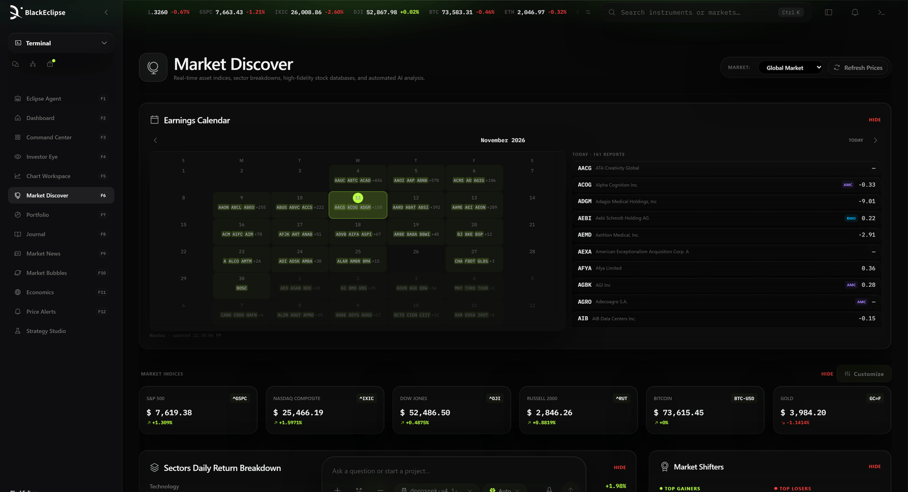
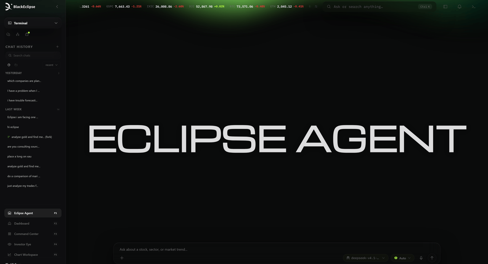
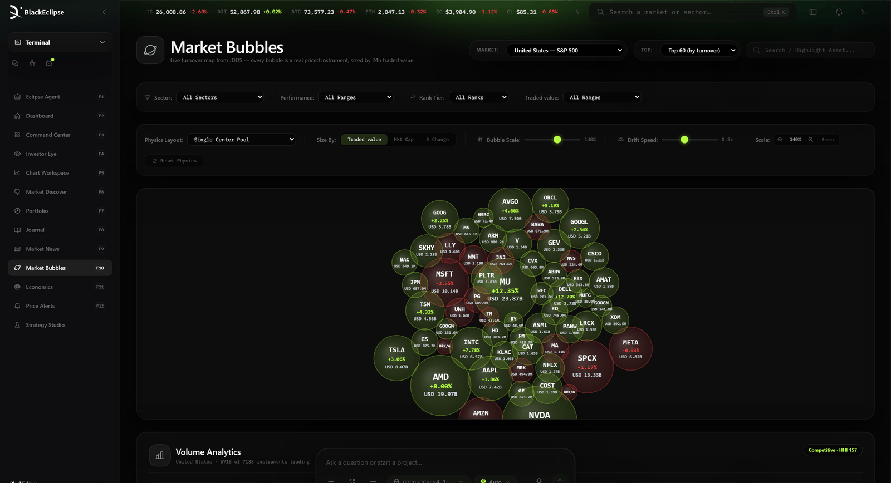
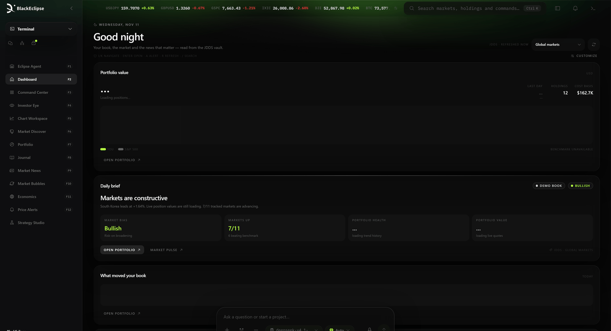
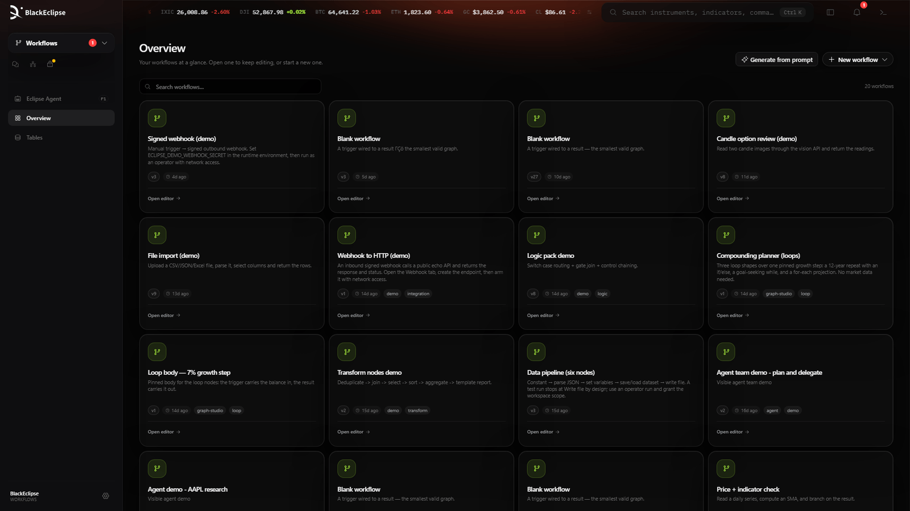
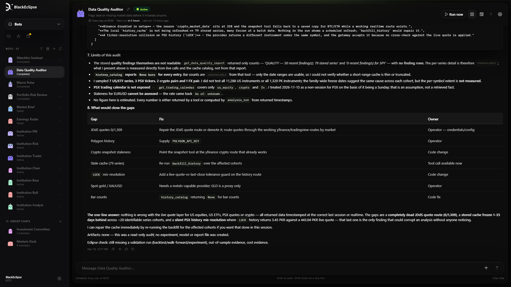

# Black Eclipse

### The Open-Source Financial AI Harness

**Research. Analyze. Build. Automate. Trade.**

[](https://github.com/desimarijuana/BlackEclipse-V1.0/releases/latest/download/BlackEclipse-Setup.exe) [](https://github.com/desimarijuana/BlackEclipse-V1.0/releases/latest/download/BlackEclipse-linux-amd64.deb) [](https://github.com/desimarijuana/BlackEclipse-V1.0/releases/latest/download/BlackEclipse-mac-arm64.dmg)

<sub>Windows 10/11 (x64) · Linux (amd64, `.deb`) · macOS (Apple silicon, `.dmg`) — Linux and macOS builds are **not** notarised or code-signed yet, so expect a Gatekeeper warning. All installers are unsigned; [verify the SHA-256](#install) or browse [all releases](https://github.com/desimarijuana/BlackEclipse-V1.0/releases).</sub>




Financial intelligence is fragmented.

Research happens in one place. Market data lives somewhere else. Quantitative
models require separate infrastructure. Trading operates independently. And AI
tools often stop at generating answers.

Investors and developers are forced to connect these pieces themselves.

**Black Eclipse brings them together.**

An open-source, AI-native financial harness that connects financial intelligence,
quantitative computing, research, AI agents, portfolio analysis, and trading into
one extensible environment.

Not just an AI assistant that talks about financial markets.

An environment that can research, calculate, develop models, test strategies,
operate tools, and execute controlled financial workflows.

**From financial information to actionable intelligence.**

**Jump to:** [Screenshots](#screenshots) · [Problems](#the-problems-were-solving) · [Different](#what-makes-black-eclipse-different) · [Capabilities](#what-you-can-do-with-eclipse) · [Architecture](#built-as-a-financial-ai-harness) · [Workflow](#from-a-research-question-to-a-tested-strategy) · [Install](#install) · [Benchmarks](#benchmarks) · [Docs](#documentation)

## Screenshots

| | |
|---|---|
|  |  |
| **Eclipse Agent** — the research surface, driven by slash commands and tools | **Market Bubbles** — real instruments sized by 24h traded value |

These are captures of the running application. They are not mockups.

<!--
  STAGED, NOT YET CAPTURED. Capture a seeded install, then add rows here:

  |  |  |
  | **Dashboard** - the daily decision surface | **Journal** - trades, analytics and reviews |
  |  |  |
  | **Graph Studio** - workflows as a typed node graph | **Bots** - agents with schedules, packs and group rooms |

  Why they are not here: a capture needs FRESH prices and a warm harness.
  A vault whose prices are days old makes the app render LIVE PRICES UNAVAILABLE
  (correctly), the bots pane sits on LOADING while it fetches threads, and the
  Graph Studio gallery needs the workflow catalog. See docs/public-readme.md §3
  and scripts/capture-readme-shots.js.
-->


## The Problems We're Solving

| # | Problem | What Eclipse does about it |
|---|---|---|
| **1** | **Fragmented Financial Information** — data providers, exchanges, websites, filings and news all live apart. | Brings collection, source routing, research and analysis into one environment. Sources carry authority scores by data type, and conflicting figures are disclosed rather than averaged. |
| **2** | **Research Takes Too Much Time** — a company means statements, fundamentals, earnings, management, news, industry. | AI research workflows collect, organize, interpret and evaluate that material, with each claim traceable to the source that produced it. |
| **3** | **Quantitative Analysis Is Inaccessible** — models need specialist tooling and infrastructure. | An environment to develop, test, evaluate and improve models and strategies with AI assistance. The engine computes; you read the result. |
| **4** | **Research and Trading Are Disconnected** — tools analyze or they execute, rarely both. | Connects research, strategy development, trade analysis and execution. With MetaTrader 5 integration it can work with trading operations. |
| **5** | **Financial Workflows Are Difficult to Automate** — the same research and monitoring, done by hand, forever. | An AI-agent architecture that makes financial workflows programmable, reusable and increasingly autonomous. |

## What Makes Black Eclipse Different?

Most financial platforms provide tools. Most AI assistants provide answers.
Black Eclipse connects the tools, the intelligence, and the execution capability
behind a financial workflow.

| | |
|---|---|
| **A harness, not just a chatbot** | Models run inside a structured environment of tools, permissions, memory, execution and financial capabilities — not a bare chat loop with a stock-price plugin. |
| **Computation, not guesswork** | Financial calculations run in deterministic engines. The model decides *what* to calculate and explains the result; it never produces the arithmetic. Every figure carries its formula, inputs, assumptions and seed. |
| **Evidence-based intelligence** | Market information is collected, cross-checked against independent lineage, and evaluated against its source. Conflicts surface instead of being silently blended. |
| **Persistent memory and learning** | Agents retain context, accept corrections, and build on prior work instead of starting from zero each session. |
| **Research connected to execution** | Research, strategy development, trade analysis and a controlled trading integration live in one environment — with the boundary between them enforced. |
| **Extensible by design** | Swap model providers, write tools, define agents, and build workflows without being locked to one vendor or one model. |

That last point is the difference between "use ChatGPT next to your broker" and
having a system: the models are interchangeable, the computation is not.

## What You Can Do With Eclipse

| Capability | What it covers | Where it lives |
|---|---|---|
| **Financial Research** | Investigate companies, securities, industries, financial statements, and market developments. | [`research/`](Black-Eclipse-site/python/harness/research/) · [docs](Black-Eclipse-site/docs/harness/search-retrieval.md) |
| **Market Intelligence** | Collect and analyze market data, fundamentals, macroeconomic information, news, and financial events. | [`market/`](Black-Eclipse-site/python/harness/market/) · [docs](Black-Eclipse-site/docs/data-sources.md) |
| **Quantitative Analysis** | Calculate financial metrics, evaluate securities, analyze portfolios, and investigate market behavior. | [`finance_facts/`](Black-Eclipse-site/python/harness/finance_facts/) · [docs](Black-Eclipse-site/docs/harness/financial-analysis-engine.md) |
| **Strategy Development** | Develop quantitative strategies, generate models, write code, and evaluate trading hypotheses. | [`quant/`](Black-Eclipse-site/python/harness/quant/) · [docs](Black-Eclipse-site/docs/quant-engine.md) |
| **Backtesting & Evaluation** | Test strategies against historical data and evaluate their performance. | [docs](Black-Eclipse-site/docs/backtesting-engine.md) · [Strategy Studio](Black-Eclipse-site/docs/strategy-studio.md) |
| **Portfolio Analysis** | Examine portfolio performance, risk, returns, exposure, and allocation. | [`portfolio/`](Black-Eclipse-site/python/harness/portfolio/) · [docs](Black-Eclipse-site/docs/portfolio-accounting.md) |
| **AI Agents** | Build an extensible environment for specialized financial agents and collaborative AI workflows. | [`agents.py`](Black-Eclipse-site/python/harness/agents.py) · [docs](Black-Eclipse-site/docs/bot-mode.md) |
| **Trading Integration** | Connect analysis and trading workflows through MetaTrader 5 integration. | [`trade/`](Black-Eclipse-site/python/harness/trade/) · [docs](Black-Eclipse-site/docs/trading.md) |
| **Automation** | Develop repeatable financial workflows that reduce manual research and operational work. | [`automation/`](Black-Eclipse-site/python/harness/automation/) · [docs](Black-Eclipse-site/docs/harness/automation-engine.md) |

## Built as a Financial AI Harness

Eclipse is not designed to be another chatbot with access to stock prices.

It is built around an extensible harness architecture that connects AI models,
tools, financial data, code execution, research capabilities, and specialized
workflows. The goal is to give agents the ability to do more than generate
answers: research, calculate, write code, execute tools, test hypotheses,
evaluate results, and improve their workflows.

| Area | What exists today | Source |
|---|---|---|
| **Extensible AI models and providers** | Provider-agnostic model runtime: OpenAI, Anthropic, Google, Mistral, Groq, any OpenAI-compatible endpoint, or Ollama locally — switched from a setting. | [`models.py`](Black-Eclipse-site/python/harness/models.py) · [`model_runtime/`](Black-Eclipse-site/python/harness/model_runtime/) |
| **Financial data and research infrastructure** | A local market-data vault, source routing, authority scoring, and cross-checks that never average a conflict away. | [`retrieval/`](Black-Eclipse-site/python/harness/retrieval/) · [`market/verification.py`](Black-Eclipse-site/python/harness/market/verification.py) |
| **Specialized skills and reusable tools** | A tool registry where every tool declares its permission and effect class. A tool that cannot declare them is not published. | [`code/tools.py`](Black-Eclipse-site/python/harness/code/tools.py) · [`tool-registry.json`](Black-Eclipse-site/docs/harness/tool-registry.json) |
| **Persistent memory and learning** | Durable agent memory with contradiction detection and a retention policy, plus a store you can correct the agent in. | [`eclipse_memory/`](Black-Eclipse-site/python/harness/eclipse_memory/) · [docs](Black-Eclipse-site/docs/harness/personal-memory.md) |
| **Code execution and quantitative computing** | Sandboxed Python: `python -I`, scrubbed environment, no provider keys, wall-clock timeout, optional container with no network. | [`quant/sdk_runtime.py`](Black-Eclipse-site/python/harness/quant/sdk_runtime.py) · [docs](Black-Eclipse-site/docs/harness/quant-sdk-sandbox.md) |
| **Agent orchestration and automation** | Durable tasks and plans with leases, fencing and retries; A2A delegation; team runs over a dependency graph; goals, loops and heartbeats. | [`tasks/`](Black-Eclipse-site/python/harness/tasks/) · [`team/`](Black-Eclipse-site/python/harness/team/) · [docs](Black-Eclipse-site/docs/harness/bot-team-orchestration.md) |
| **Trading and strategy integrations** | MetaTrader 5 read paths, single-use order approvals, demo mandates, margin caps, reconciliation and a kill switch. | [`trade/`](Black-Eclipse-site/python/harness/trade/) · [docs](Black-Eclipse-site/docs/trading.md) |

### Why it is a harness and not a wrapper

The model plans and explains. It never does the arithmetic: calculations run in
Python and return their formula, inputs, assumptions and seed, so the same
question produces the same number or an honest `UNAVAILABLE`. The same rule
applies to trading — **no layer outside
[`quant/`](Black-Eclipse-site/python/harness/quant/) may compute a trading
statistic**, and research and execution stay separate products.

## From a research question to a tested strategy

The six steps below are the reason the pieces exist in one place.

| Step | What happens | What you get |
|---|---|---|
| **1. Research** | Ask about a company, market or instrument. The agent plans and selects tools. | A plan and the tool calls it made, visible in the run. |
| **2. Collect evidence** | Retrieval pulls from the local vault, configured providers and the web; sources are scored by authority for their data type. | Claims with source handles; a leg it cannot source returns `UNAVAILABLE`. |
| **3. Analyze** | Metrics, ratios, valuation and risk run through deterministic calculators. | Numbers with formula, inputs and assumptions attached. |
| **4. Build** | Author the strategy as a versioned IR, a visual graph, or sandboxed Python. | A strategy version you can point at. |
| **5. Evaluate** | Backtest with an anti-lookahead loop, walk forward, stress the assumptions. | Equity curve, Deflated Sharpe, probability of backtest overfitting, and a grade. |
| **6. Execute — where authorized** | A live trial needs an approved version, a completed backtest, a typed confirmation, an armed connection and a margin cap. | One order under a mandate — or a named refusal explaining what is missing. |

## Who Is Black Eclipse For?

| | |
|---|---|
| **Individual investors** | Research companies, understand financial information, evaluate portfolios, and make more informed decisions — with the tooling to check the reasoning. |
| **Quantitative traders** | Develop strategies, build models, backtest hypotheses, analyze trades, and investigate market behaviour. |
| **Financial researchers** | Work with financial data, fundamentals, filings, market intelligence and quantitative analysis in one environment. |
| **Developers** | Build financial agents, extend the harness, add tools, connect models, and automate workflows. |
| **Researchers and builders** | Experiment with AI-driven financial systems and build specialised applications on an extensible harness. |

## Install

**Windows desktop** — the front door:

```bash
cd Black-Eclipse-site
npm install              # also provisions the Python agent runtime
npm run desktop:refresh  # build + open the desktop app (port 3100)
```

Or take the installer for your platform — [Windows](https://github.com/desimarijuana/BlackEclipse-V1.0/releases/latest/download/BlackEclipse-Setup.exe) ·
[Linux](https://github.com/desimarijuana/BlackEclipse-V1.0/releases/latest/download/BlackEclipse-linux-amd64.deb) ·
[macOS](https://github.com/desimarijuana/BlackEclipse-V1.0/releases/latest/download/BlackEclipse-mac-arm64.dmg) ·
[all releases](https://github.com/desimarijuana/BlackEclipse-V1.0/releases).

No account and no manual database setup. First boot provisions and seeds the local
vault and starts the agent runtime. To use a model, either add a key for a
supported hosted provider or configure a local Ollama provider in
**Settings · AI**.

| Platform | Artifact | Signing |
|---|---|---|
| Windows 10/11 (x64) | `BlackEclipse-Setup.exe` (NSIS) | unsigned |
| Linux (amd64) | `BlackEclipse-linux-amd64.deb` | unsigned |
| macOS (Apple silicon) | `BlackEclipse-mac-arm64.dmg` | unsigned — no Apple Developer certificate is configured, so Gatekeeper will warn |

**Verify before you run it.** The installers are unsigned, so every release
publishes `SHA256SUMS.txt` next to the binaries. Check the file you downloaded:

```powershell
# Windows PowerShell
Get-FileHash .\BlackEclipse-Setup.exe -Algorithm SHA256
# compare the output with the line for that file in SHA256SUMS.txt
```

```bash
# macOS / Linux
shasum -a 256 BlackEclipse-Setup.exe   # or: sha256sum ...
```

A mismatch means the download is not the artifact we published — delete it.

**The harness alone** — the runtime with no app data, vault or credentials:

```bash
# PyPI release is pending; install from source today:
pip install "git+https://github.com/desimarijuana/BlackEclipse-V1.0.git#subdirectory=Black-Eclipse-site"
```

**Troubleshooting** (the first three failures, in order):

| Symptom | Cause | Fix |
|---|---|---|
| Agent runs fail with `503 runtime unavailable` | Python runtime missing or broken | `npm run desktop:doctor` from `Black-Eclipse-site/`, then relaunch |
| Every model call fails | No provider configured | **Settings · AI** — add a key, or point at Ollama on `http://localhost:11434` |
| Empty screens after first launch | Vault seed interrupted | Relaunch; the boot hook re-seeds. `npm run desktop:doctor` reports what is missing |

## First working example

**Smoke test** — prove the runtime is alive without a provider, network or data
file:

```bash
python -m harness.evaluation.conformance --quick
python -m harness.acp --self-test
```

**Embed it** — the same agents, tools and providers without the app:

```python
import asyncio
from harness.public import AgenticService, RunInput, RunRequest, ModelSettings

async def main():
    service = AgenticService()
    result = await service.run(RunRequest(
        runId="research-1",
        input=RunInput(query="Summarise the last quarter for this ticker and cite the filings."),
        modelSettings=ModelSettings(provider="ollama", model="llama3.1",
                                    base_url="http://localhost:11434/v1"),
        callbackBaseUrl="http://localhost:3000",
    ))
    print(result.status, result.output)

asyncio.run(main())
```

A run returns a status and an output whose claims carry source handles. A claim
the run could not source is returned as `UNAVAILABLE` rather than estimated, and
the whole run — plan, tool calls, receipts — stays inspectable afterwards. That
is the contract; the numbers you see are the ones the engine computed.

## Benchmarks

Two tiers, kept apart on purpose: the offline tier measures the **runtime** with a
scripted model, the live tier measures the **agent** with a real one.

| Offline · runtime | Live · agent |
|---|---|
| task_success **0.9970** · safety **1.0000** · hallucination **0.0000** · gate **PASS** | task_success **0.9748** · financial_accuracy **0.9963** · citation_accuracy **1.0000** · gate **PASS** |

`evalrun-1794502740168` (tier 0) and `evalrun-1794281772755` (tier 1, pinned
`live:27c280164943e63520e14422a6c953cf`).

**Methodology, so you can attack the numbers properly:**

| Question | Answer |
|---|---|
| How many tasks? | **347** across **15** versioned datasets (`corpus_manifest.json`, recorded 2026-11-12), split validation 253 / optimization 88 / held-out 6 |
| How many graded by an oracle rather than prose? | 271 of 347 (78.1% oracle coverage); 76 tasks are deliberately oracle-exempt |
| How many trials in the pinned live run? | 278 measured trials, 278 tasks |
| Is it reproducible? | Yes — the corpus manifest is checksummed and recomputed by `verify_manifest()`, and each published run records its dataset checksum, agent version, git commit, grader version and pinned live id |
| How is `financial_accuracy` measured? | Not by a model. `FinancialGrader` independently recomputes the expected value with `harness.research.calculations` and compares the agent's number within a declared tolerance |
| Which model produced the live numbers? | The pinned run records its model and provider in the run artefact. This table does not pin a vendor because the harness is provider-agnostic; re-running on another model produces different numbers, and we would rather say so |
| What does it **not** measure? | Returns. Robustness of a strategy. Real-world citation coverage. Several dimensions are unmeasured and print `UNKNOWN` — not zero, not pass |

A `1.0000` citation score is a statement about this corpus, not about the open
web. Method and provenance:
[`docs/harness/benchmarks.md`](Black-Eclipse-site/docs/harness/benchmarks.md) ·
[`docs/harness/agent-evaluation.md`](Black-Eclipse-site/docs/harness/agent-evaluation.md).

## Documentation

| Start here | What it answers |
|---|---|
| [QUICKSTART](Black-Eclipse-site/docs/QUICKSTART.md) | How do I run it and see something working? |
| [OVERVIEW](Black-Eclipse-site/docs/OVERVIEW.md) | What is this product, and what is the mental model? |
| [ARCHITECTURE](Black-Eclipse-site/docs/ARCHITECTURE.md) | What are the layers and the big moving parts? |
| [NAVIGATION](Black-Eclipse-site/docs/NAVIGATION.md) | Which file do I open to change X? |
| [Harness](Black-Eclipse-site/docs/harness/architecture.md) | How the runtime, tools, policy and evaluation work |
| [Trading](Black-Eclipse-site/docs/trading.md) | Broker connections, mandates, approvals and the kill switch |

## Roadmap and current limitations

There is no dated roadmap, on purpose. These two documents are the roadmap, and
a capability that is not in them is not promised:

- **[PRODUCTION-READINESS](Black-Eclipse-site/docs/PRODUCTION-READINESS.md)** —
  the gates still open for production use.
- **[OPEN-SOURCE-READINESS](Black-Eclipse-site/docs/OPEN-SOURCE-READINESS.md)** —
  what is left before this repository is public.

Known limits, stated plainly:

- **`v0.4.0` is single-operator and self-hosted.** It is not a multi-tenant
  service and does not pretend to be.
- **The Python package is not on PyPI yet.** The install above says so.
- **Installers are unsigned**, so SmartScreen and Gatekeeper will warn. Verify
  the checksum instead.
- **Coverage is uneven across markets.** The vault fills over time; a thin market
  shows `UNAVAILABLE` rather than a synthetic quote.
- **Benchmarks measure the agent, not a strategy.** A passing gate says nothing
  about returns.

## Open Source

Black Eclipse is being built as an open-source project. Our goal is to give
developers, researchers, quantitative traders and investors the tools to build,
extend and customize their own financial AI environments.

- [**Contributing**](Black-Eclipse-site/CONTRIBUTING.md) — setup, DCO, release gate
- [**Security**](SECURITY.md) — private advisories, never a public issue
- [**Code of conduct**](CODE_OF_CONDUCT.md)
- [**Issues**](https://github.com/desimarijuana/BlackEclipse-V1.0/issues) — bug reports, feature requests, and questions

### Licensing, precisely

| Component | License |
|---|---|
| The application and this repository's original code | **MIT** — see [`LICENSE`](LICENSE) |
| `Black-Eclipse-site/pine-engine/` — the isolated Pine Script engine | **AGPL-3.0-only**, because it depends on `pinets`. It is a separate program that talks to the app only through files — see [`NOTICE.md`](Black-Eclipse-site/pine-engine/NOTICE.md) |

If you redistribute the app, the MIT terms cover it. If you run the Pine engine
as part of a network service, AGPL-3.0-only applies to **that component** and its
obligations are described in its NOTICE.

---

**Trading disclaimer.** Black Eclipse is research and analysis software. It is
not investment advice, and it does not make decisions for you. Research does not
authorize trading: an order requires the operator's approval, and live execution
additionally requires an armed connection and a capped mandate. Demo and live are
distinct modes. Backtest results do not guarantee live performance. Black Eclipse
is not affiliated with, endorsed by, or derived from any terminal vendor.

**Black Eclipse**

*An open-source financial AI harness.*
